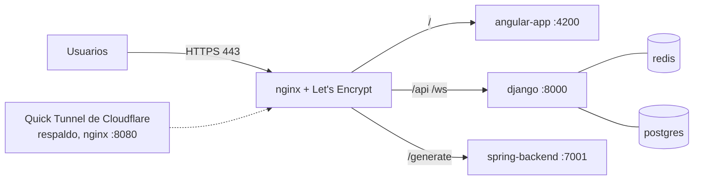

# Despliegue en AWS (EC2) con dominio y HTTPS

Estado verificado el **2026-11-04** (con el segundo parcial desplegado y MongoDB Atlas activo). Sitio: **https://diagramador.dev**

## 1. Resumen

Todo corre en **una instancia EC2** (Ubuntu 24.04, 2 vCPU, ~2 GB de RAM) con Docker Compose. **nginx** recibe el tráfico en los puertos 80/443, termina HTTPS (certificado de Let's Encrypt) y reparte hacia los servicios. El dominio lo gestiona name.com (registro `A` hacia la IP pública de la instancia).



El frontend decide sus direcciones al abrirse la página (`front_generador_bd/src/environments/environment.ts`): con HTTPS usa el mismo origen (`/api`, `/ws`, `/generate`), con HTTP directo (solo en local, donde esos puertos están publicados) usa los puertos 8000 y 7001. Por eso un mismo build sirve para el dominio, el túnel y el acceso directo.

## 2. Componentes

| Servicio | Contenedor | Puerto interno | Notas |
|---|---|---|---|
| Frontend Angular SSR | `angular_frontend` | 4000 (publicado como 4200) | Imagen construida desde `front_generador_bd/Dockerfile` |
| API + WebSockets | `django_backend_UML` | 8000 | Django 5, Channels, Daphne |
| Generador | `spring_backend` | 7001 | Spring Boot 3.5, Java 21 |
| Redis | `redis_server` | 6379 | Capa de canales, roles de sala, turno de la IA por sala y topes de uso de la ayuda |
| PostgreSQL | `postgres_db` | 5432 (publicado como 5433) | Participantes, topes de la IA, respaldo de diagramas y, por defecto, la actividad y la conversación |
| MongoDB Atlas (nube) | — (no es un contenedor del servidor) | 27017, hacia el clúster `diagramador` | Actividad y conversación con la IA: `ACTIVITY_STORE` y `CONVERSATION_STORE` valen `mongo` desde el 2026-11-04 (sección 8) |
| MongoDB local (opcional, perfil `mongo`) | `mongo_db` | 27017 (solo `127.0.0.1` del host) | Alternativa para correr MongoDB en la propia máquina (sección 8). No arranca con `up -d` a secas y no está en uso en el servidor |
| pgAdmin | `pgadmin` | 80 (publicado como 5050) | Solo administración |

Todos los contenedores tienen política de reinicio `unless-stopped`; Docker y nginx arrancan con la máquina.

## 3. Configuración (nombres de variables, nunca valores)

- `back_generador_bd/.env` (no versionado): `DJANGO_SECRET_KEY`, `DEBUG` (**debe ser `False`**), `DJANGO_ALLOWED_HOSTS`, `CORS_ALLOWED_ORIGINS`, `CSRF_TRUSTED_ORIGINS`, `POSTGRES_*`, `REDIS_*`, `GEMINI_API_KEY`, `GEMINI_MODEL`, `ACTIVITY_STORE`, `CONVERSATION_STORE`, `MONGO_URL` (con la clave del usuario de Atlas; solo en el servidor) y `MONGO_DB` y, solo si se levanta el contenedor `mongo_db`, `MONGO_INITDB_ROOT_USERNAME` y `MONGO_INITDB_ROOT_PASSWORD`. El dominio nuevo debe agregarse a las tres listas.
- `.env` en la raíz del repositorio (no versionado): `APP_CORS_ALLOWED_ORIGINS`, orígenes extra separados por comas que Spring **suma** a los suyos (ver `SecurityConfiguration`). Se pasa al contenedor desde `docker-compose.app.yml`.
- Los archivos `.env` nunca se suben a git.

## 4. Desplegar un cambio

El servidor usa `docker-compose` (binario independiente), no `docker compose`. Se actualiza **un servicio a la vez** para no cortar el resto:

1. Respaldar la imagen actual por su identificador (`docker tag <id> <imagen>:antes-<fecha>`).
2. Traer el código: `git pull --ff-only <url-del-repositorio> develop` (si hay ediciones sin guardar, se detiene).
3. Reconstruir solo ese servicio: `docker-compose -f docker-compose.app.yml build <servicio>` (`angular-app` o `spring-backend`). Los contenedores actuales siguen funcionando durante el build.
4. Comprobar que la imagen cambió y reiniciar solo ese servicio: `docker-compose -f docker-compose.app.yml up -d --no-deps <servicio>`.
5. Pruebas de humo (sección 6).

Una instancia pequeña puede tardar varios minutos construyendo el frontend; conviene hacerlo sin usuarios conectados. Al reiniciar `django` se ejecuta `manage.py clear_room_state` (antes de `daphne`): borra de Redis los grupos de salas, así que nadie queda "fantasma"; quienes estaban conectados deben volver a entrar.

### Volver atrás

```bash
docker tag <id-imagen-anterior> <imagen>:latest
docker-compose -f docker-compose.app.yml up -d --no-deps --no-build <servicio>
```

Para el `.env` de Django, restaurar la copia `.env.bak-<fecha>` y recrear el servicio con `up -d --no-deps --force-recreate django`.

### Último despliegue (2026-11-07, clase asociativa UML y relaciones recursivas)

Se desplegó `develop` en `37c3dd0` (la fusión del pull request 6) sin usuarios conectados (0 grupos `asgi:group:*` en Redis y 0 conexiones al puerto 8000). Antes se respaldaron las tres imágenes (`django`, `angular-app` y `spring-backend`) como `antes-20261107-1553` y el commit anterior (`f82872d`) en `~/respaldos-despliegue/head-antes-20261107-1553.txt`. Se hizo `git pull --ff-only origin develop` y `~/respaldos-despliegue/deploy-20261107.sh` reconstruyó y levantó de a un servicio con `up -d --no-deps`: `spring-backend` (el generador cambió), `angular-app` (el editor cambió) y `django` solo se reinició, porque su código está montado (`./back_generador_bd:/app`) y no cambió ninguna dependencia. La construcción de Angular tardó unos 3 minutos. Después: `scripts/smoke-test.sh` con las 12 comprobaciones en orden, y la generación de proyectos en el sitio con los casos de relación recursiva 1:N, relaciones paralelas y N:M recursiva (Spring y Flutter respondieron 200; los campos de relación no se repiten; el formulario Flutter no exige el padre `0..1` y sí el departamento `1`). Para volver atrás: `docker tag diagramador_uml_examen2-<servicio>:antes-20261107-1553 diagramador_uml_examen2-<servicio>:latest`, `git checkout f82872d` y recrear el servicio con `up -d --no-deps --no-build <servicio>`.

Más tarde ese mismo día (16:53) se fusionó el pull request 8 (arreglo del generador de Flutter con IA local: versiones exactas de `llamadart` y permisos de voz de iOS) y se llevó el servidor a `54de5d5`. Solo cambiaron archivos Python montados en el contenedor de Django y documentos, así que bastó `git pull --ff-only origin develop` y `docker-compose -f docker-compose.app.yml restart django`, sin usuarios conectados (el HEAD anterior, `37c3dd0`, quedó en `~/respaldos-despliegue/head-antes-20261107-1653.txt`). Después: `scripts/smoke-test.sh` 12 de 12 y un proyecto Flutter generado en el sitio con `llamadart: 0.8.24`, `llamadart_llama_cpp_flutter: 0.0.19`, el script de iOS con los permisos de voz y el formulario con el padre `0..1` opcional.

### Despliegue anterior (2026-11-04, segundo parcial)

Se desplegó `develop` en `ac1efb6` (la fusión del pull request 2) sin usuarios conectados. Antes se respaldaron las imágenes `django` y `angular-app` como `antes-20261104-1559` y el commit anterior (`6710b82`) en `~/respaldos-despliegue/head-antes-20261104-1559.txt`. `spring-backend` no cambió y no se tocó. Se hizo `git pull --ff-only origin develop`, se construyeron `django` (ahora con `pymongo` y `mongomock`) y `angular-app` con `docker-compose -f docker-compose.app.yml build <servicio>` y se reiniciaron uno a la vez con `up -d --no-deps`. Al arrancar, Django aplicó la migración `collab.0005_chatmessage_author_name` (una columna y un índice). Resultado: `scripts/smoke-test.sh` en orden; la ayuda respondió una pregunta real y rechazó una fuera de tema; `/api/chatbot/` (eliminado) responde 404. Ese mismo día, después, se activó MongoDB Atlas (sección 8; además se trajo el arreglo del PR 4 y se recreó `django` dos veces más). Para volver atrás: volver a etiquetar como `latest` las dos imágenes `antes-20261104-1559` (`docker tag`, como en «Volver atrás») y, en el servidor, `git checkout 6710b82` (el código de Django se monta desde esa carpeta).

## 5. Dominio y HTTPS

1. Dominio registrado en name.com (oferta de GitHub Student Developer Pack, primer año gratis). **La renovación automática está apagada: vence el 2027-10-21** y hay que renovarlo a mano o cambiar de nombre antes.
2. Registro `A` (host vacío) hacia la IP pública de la instancia, TTL 300.
3. Sitio nginx propio para el dominio en el puerto 80 con el mismo reparto de rutas que el del túnel (`/api/`, `/ws/` con Upgrade, `/generate`, `/`).
4. Certificado: `sudo certbot --nginx -d <dominio> --redirect -m <correo> --agree-tos --no-eff-email --non-interactive`. Certbot agrega el servidor 443 y la redirección 301. La renovación la hace el temporizador `certbot.timer`.
5. Si la IP pública de la instancia puede cambiar (apagado y encendido), asignar una IP elástica. Con MongoDB Atlas (sección 8) es más importante: Atlas solo acepta la IP del servidor, y si cambia hay que agregar la nueva en su lista de IP permitidas.

## 6. Pruebas de humo

**Un solo comando:** `scripts/smoke-test.sh [dominio]` ejecuta todas las comprobaciones siguientes (más el cierre de los puertos 4200, 7001 y 8000) y termina con código 0 si todo está bien. Solo lee, no modifica nada. Última corrida: 2026-11-07, todo en orden (12 comprobaciones, tras desplegar la clase asociativa y las relaciones recursivas). Tarda unos 3 minutos.

Desde cualquier equipo, sustituyendo el dominio:

```bash
curl -s -o /dev/null -w '%{http_code}\n' https://<dominio>/                       # 200
curl -s -w ' %{http_code}\n' https://<dominio>/api/get_backup_uml/00000000-0000-0000-0000-000000000000/   # JSON de error, 404
curl -s -o /dev/null -w '%{http_code}\n' http://<dominio>/                         # 301 hacia https
curl -s -X POST https://<dominio>/generate -H 'Content-Type: application/json' \
  --data '{"classes":[{"id":"c1","name":"Persona","attributes":[{"name":"id","type":"int"}],"methods":[]}],"relationships":[]}' \
  -o /tmp/prueba.zip -w '%{http_code}\n'                                           # 200 y un ZIP
```

WebSocket: una petición HTTP/1.1 con `Upgrade: websocket` a `/ws/canvas/<sala>/` debe responder `101 Switching Protocols`.

## 7. Seguridad y estado conocido

- `DEBUG=False` en Django. Los secretos viven en archivos `.env` fuera de git. La contraseña de PostgreSQL se rotó el 2026-10-22 (la anterior estaba en el historial público de git); para rotarla de nuevo: `ALTER USER … PASSWORD …` dentro del contenedor de Postgres, actualizar `POSTGRES_PASSWORD` en `back_generador_bd/.env` y recrear `django` (`up -d --no-deps --force-recreate django`). Cambiar solo la variable **no** cambia la clave guardada dentro de la base.
- El grupo de seguridad deja abiertos **solo 22, 80 y 443** (los puertos directos 4200, 7001 y 8000 se cerraron el 2026-10-21; todo entra por nginx). **Pendiente recomendado:** limitar el 22 a la IP del administrador (riesgo: si esa IP cambia, hay que editar la regla desde la consola de AWS).
- Redis, PostgreSQL y pgAdmin están publicados en el host (6379, 5433, 5050) pero el grupo de seguridad no los abre al exterior. No abrirlos.
- **Modelo de acceso (decisión de diseño, RF-17):** no hay cuentas; el **código de la sala es la capacidad**. Quien lo conoce puede editar, expulsar (si es host) y leer el historial, la actividad y la conversación con la IA de esa sala (desde el segundo parcial la conversación es una sola para toda la sala). La vista móvil de seguimiento (`/sala/<id>/seguir`) es de **solo lectura por diseño de la interfaz y del servidor para esa conexión**, pero **no es un límite de seguridad**: el enlace contiene el mismo código y quien lo recibe puede abrir la sala como editor. Si algún día hiciera falta separar permisos habría que emitir códigos distintos de lectura y de edición.
- **Atribución a la IA:** las operaciones marcadas `via_ia` las envía el navegador de quien pidió el cambio; el servidor las registra como "IA, a pedido de X" pero no puede demostrar que vengan de una respuesta real de la IA. Es un registro de transparencia, no una auditoría a prueba de manipulación.
- **Costo de la IA:** el asistente de ayuda (`POST /api/ia/help/`) tiene sus propios topes, 6 preguntas por minuto por persona y 30 por minuto en total, contados en Redis. El servidor limita los pedidos por participante (12/min), por sala (30/min) y en total (60/min), y cada conexión puede cambiar de identidad como máximo 5 veces. El cupo se **reserva antes de llamar al proveedor** y se cuenta aunque el proveedor falle, así que ni los pedidos simultáneos ni una IA caída permiten pasar el tope. El tope global y el de sala no dependen de identificadores elegidos por el cliente. La validación del modelo (`/ws/uml/`) tiene además un tope del servicio: 3 validaciones a la vez y 20 por minuto, y una ráfaga de pedidos de una conexión se reduce a la primera y a una última con el diagrama más reciente.
- **Seguidores de la vista móvil:** el pedido de estado completo de un seguidor llega solo al host (no a todos los editores), con un pedido por segundo por sala y como máximo 10 seguidores por sala. Estos topes, y los de actividad por conexión, se cuentan **en el proceso**: con varios procesos de Django se multiplicarían por la cantidad de procesos. Hoy corre un solo proceso (daphne). El turno de la IA por sala y los topes de la ayuda sí viven en Redis y valen para todos los procesos.
- **Cambios de la IA:** el servidor rechaza cambios enormes y la interfaz pide confirmación antes de aplicar uno que elimina elementos (el modelo lee el contenido del diagrama, que puede venir de una importación). Cuenta como eliminación lo marcado con `eliminar` y también lo que la respuesta deja fuera de una clase que ya existía (el editor reemplaza los atributos y métodos de una clase existente por los que trae el cambio), comparando con el diagrama que envió el navegador.
- **Ideas de la revisión:** aplicar una idea tiene tres pasos (reservar, confirmar o liberar). La reserva vence a los 150 s si nadie la confirma ni la libera (por ejemplo, se cerró la pestaña), y la confirmación y la liberación se reintentan si falla la red. Quien fue **expulsado** se va sin guardar el respaldo final: su copia pudo quedar atrasada.
- No hay CI/CD ni infraestructura como código: el despliegue es manual y repetible con los pasos de la sección 4.
- El **Quick Tunnel de Cloudflare** sigue como respaldo, pero es un proceso manual (no un servicio) y su dirección cambia si se reinicia. Si cambia, agregarla a `APP_CORS_ALLOWED_ORIGINS` y reiniciar Spring.

## 8. MongoDB (construcción C3)

### En producción: MongoDB Atlas (desde el 2026-11-04)

La actividad de la sala y la conversación con la IA se guardan en **MongoDB Atlas**, el servicio gestionado de MongoDB, y no en un contenedor del servidor: plan gratuito (512 MB de almacenamiento), AWS región N. Virginia, clúster `diagramador` (MongoDB 8.0). Así MongoDB no usa la memoria de la máquina de 2 GB. PostgreSQL sigue guardando los participantes, los topes de uso de la IA y el respaldo del diagrama.

- **Acceso:** el usuario de base de datos `diagramador_app` (con permisos de administración del proyecto de Atlas) y una lista de IP permitidas que solo tiene la del servidor (`18.188.167.127/32`). La clave vive únicamente dentro de `MONGO_URL`, en `back_generador_bd/.env` del servidor; nunca va a git.
- **Variables del servidor** (`back_generador_bd/.env`): `MONGO_URL` (`mongodb+srv://…`), `MONGO_DB=diagramador`, `ACTIVITY_STORE=mongo` y `CONVERSATION_STORE=mongo`. La copia del `.env` anterior al cambio es `.env.bak-20261104-1634`.
- **Cómo se hizo, en este orden:** (1) código y las variables `MONGO_URL` y `MONGO_DB` en el servidor, sin cambiar de base; (2) prueba de conexión desde el contenedor (primera conexión 0,4 s, ida y vuelta de unos 15 ms); (3) las 19 pruebas de contrato de los adaptadores contra Atlas con `docker exec django_backend_UML sh -c 'MONGO_TEST_URL="$MONGO_URL" python manage.py test collab.tests.test_mongo_integration --settings=diagramador_uml.settings_test'` (crean y borran bases `prueba_…`); (4) `docker exec django_backend_UML python manage.py migrar_a_mongo`: 34 eventos y 10 mensajes, iguales a los de PostgreSQL salvo la hora, que Mongo guarda a milisegundos, y el nombre de autor de los mensajes viejos, que toma el del participante (se repitió sin duplicar); (5) `ACTIVITY_STORE=mongo` y `CONVERSATION_STORE=mongo` y `up -d --no-deps --force-recreate django`; (6) prueba de punta a punta dentro del servidor: una persona simulada editó el diagrama por WebSocket y preguntó a la IA; el evento y los dos mensajes quedaron en Atlas (PostgreSQL no creció) y el historial se leyó de Atlas.
- **Si Atlas no responde o la IP del servidor cambia:** el chat compartido y el registro de actividad fallan; la edición del diagrama entre las personas sigue funcionando. Para volver a PostgreSQL: poner `postgres` en las dos variables (o borrar esas dos líneas) y recrear `django`. **Lo escrito en Atlas desde el cambio no se copia de vuelta a PostgreSQL** (no hay comando para eso). Si la IP cambia y se quiere seguir con Atlas, basta agregar la IP nueva en «Network Access» de Atlas; por eso conviene reservar una IP elástica (sección 5).
- **Los datos de las salas están en una nube de un tercero** (MongoDB, Inc., sobre AWS). Lo que los protege es la lista de IP permitidas y la clave.

### Alternativa: MongoDB en un contenedor propio

Por defecto la actividad y la conversación se guardan en PostgreSQL. Para guardarlas en un MongoDB que corra en la propia máquina:

1. Poner en `back_generador_bd/.env` los nombres de la sección 3 (las claves solo en el servidor, nunca en git) y levantar el servicio con su perfil: `docker-compose -f docker-compose.db.yml --env-file back_generador_bd/.env --profile mongo up -d mongo`. Usa `mongo:7` con autenticación (`--auth`), la caché de WiredTiger acotada a 0,25 GB y el puerto publicado solo en `127.0.0.1`. El servicio no está en la ejecución normal (`up -d` levanta solo PostgreSQL y pgAdmin) y recibe únicamente `MONGO_INITDB_ROOT_USERNAME` y `MONGO_INITDB_ROOT_PASSWORD`, no el `.env` completo. Si `--env-file` se olvida, esas dos variables quedan vacías: no se crea ningún usuario y, con `--auth`, una conexión desde otro contenedor o desde fuera no puede leer ni escribir (comprobado el 2026-11-04 con contenedores de prueba). El perfil exige `docker-compose` 1.28 o más nuevo en el servidor (`docker-compose --version`).
2. Copiar el historial que ya existe: `docker exec django_backend_UML python manage.py migrar_a_mongo` (se puede repetir sin duplicar y no toca PostgreSQL, que queda como respaldo).
3. Poner `ACTIVITY_STORE=mongo` y `CONVERSATION_STORE=mongo` y recrear `django` (`up -d --no-deps --force-recreate django`). Volver atrás es poner `postgres` en las dos variables.

**Por qué el servidor usa Atlas y no este contenedor.** Medición en la EC2 de 2 GB (2026-11-04), con todos los servicios corriendo y sin MongoDB: 1.906 MB de memoria en total, de 690 a 817 MB usados, de 1.088 a 1.267 MB disponibles (la caché cuenta como disponible) y de 537 a 686 MB de swap en uso; los seis contenedores suman unos 150 MB. Con la caché de WiredTiger en 0,25 GB un contenedor cabría, pero la máquina ya usa swap; con Atlas solo cambia `MONGO_URL`. Para medir de nuevo: `docker stats --no-stream` y `free -m`. Las pruebas contra un MongoDB real se corren con `MONGO_TEST_URL` (ver la sección 2.5 del informe).
