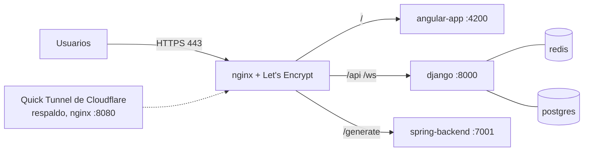

# Despliegue en AWS (EC2) con dominio y HTTPS

Estado verificado el **2026-11-09** (con MongoDB Atlas, el acceso con el correo con cuentas recordadas, las invitaciones, los roles, «Mis diagramas» y las herramientas por clic). Sitio: **https://diagramador.dev**

## 1. Resumen

Todo corre en **una instancia EC2** (Ubuntu 24.04, 2 vCPU, ~2 GB de RAM) con Docker Compose. **nginx** recibe el tráfico en los puertos 80/443, termina HTTPS (certificado de Let's Encrypt) y reparte hacia los servicios. El dominio lo gestiona name.com (registro `A` hacia la IP pública de la instancia).



El frontend decide sus direcciones al abrirse la página (`front_generador_bd/src/environments/environment.ts`): con HTTPS usa el mismo origen (`/api`, `/ws`, `/generate`), con HTTP directo (solo en local, donde esos puertos están publicados) usa los puertos 8000 y 7001. Por eso un mismo build sirve para el dominio, el túnel y el acceso directo.

## 2. Componentes

| Servicio | Contenedor | Puerto interno | Notas |
|---|---|---|---|
| Frontend Angular SSR | `angular_frontend` | 4000 (publicado como 4200) | Imagen construida desde `front_generador_bd/Dockerfile` |
| API + WebSockets | `django_backend_UML` | 8000 | Django 5, Channels, Daphne |
| Generador | `spring_backend` | 7001 | Spring Boot 3.5, Java 21 |
| Redis | `redis_server` | 6379 | Capa de canales, roles de sala, turno de la IA por sala y topes de uso de la ayuda |
| PostgreSQL | `postgres_db` | 5432 (publicado como 5433) | Participantes, topes de la IA, respaldo de diagramas y, por defecto, la actividad y la conversación |
| MongoDB Atlas (nube) | — (no es un contenedor del servidor) | 27017, hacia el clúster `diagramador` | Actividad y conversación con la IA: `ACTIVITY_STORE` y `CONVERSATION_STORE` valen `mongo` desde el 2026-11-04 (sección 8) |
| MongoDB local (opcional, perfil `mongo`) | `mongo_db` | 27017 (solo `127.0.0.1` del host) | Alternativa para correr MongoDB en la propia máquina (sección 8). No arranca con `up -d` a secas y no está en uso en el servidor |
| pgAdmin | `pgadmin` | 80 (publicado como 5050) | Solo administración |

Todos los contenedores tienen política de reinicio `unless-stopped`; Docker y nginx arrancan con la máquina.

## 3. Configuración (nombres de variables, nunca valores)

- `back_generador_bd/.env` (no versionado): `DJANGO_SECRET_KEY`, `DEBUG` (**debe ser `False`**), `DJANGO_ALLOWED_HOSTS`, `CORS_ALLOWED_ORIGINS`, `CSRF_TRUSTED_ORIGINS`, `POSTGRES_*`, `REDIS_*`, `GEMINI_API_KEY`, `GEMINI_MODEL`, `AUTH_REQUIRED` (**`True` en producción**; apagado por defecto), `AUTH_SESSION_DAYS`, `PUBLIC_APP_URL`, `EMAIL_HOST`, `EMAIL_PORT`, `EMAIL_HOST_USER`, `EMAIL_HOST_PASSWORD` (la clave del servicio de correo, solo en el servidor) y `DEFAULT_FROM_EMAIL`, `ACTIVITY_STORE`, `CONVERSATION_STORE`, `MONGO_URL` (con la clave del usuario de Atlas; solo en el servidor) y `MONGO_DB` y, solo si se levanta el contenedor `mongo_db`, `MONGO_INITDB_ROOT_USERNAME` y `MONGO_INITDB_ROOT_PASSWORD`. El dominio nuevo debe agregarse a las tres listas.
- `.env` en la raíz del repositorio (no versionado): `APP_CORS_ALLOWED_ORIGINS`, orígenes extra separados por comas que Spring **suma** a los suyos (ver `SecurityConfiguration`). Se pasa al contenedor desde `docker-compose.app.yml`.
- Los archivos `.env` nunca se suben a git.

## 4. Desplegar un cambio

El servidor usa `docker-compose` (binario independiente), no `docker compose`. Se actualiza **un servicio a la vez** para no cortar el resto:

1. Respaldar la imagen actual por su identificador (`docker tag <id> <imagen>:antes-<fecha>`).
2. Traer el código: `git pull --ff-only <url-del-repositorio> develop` (si hay ediciones sin guardar, se detiene).
3. Reconstruir solo ese servicio: `docker-compose -f docker-compose.app.yml build <servicio>` (`angular-app` o `spring-backend`). Los contenedores actuales siguen funcionando durante el build.
4. Comprobar que la imagen cambió y reiniciar solo ese servicio: `docker-compose -f docker-compose.app.yml up -d --no-deps <servicio>`.
5. Pruebas de humo (sección 6).

Una instancia pequeña puede tardar varios minutos construyendo el frontend; conviene hacerlo sin usuarios conectados. Al reiniciar `django` se ejecuta `manage.py clear_room_state` (antes de `daphne`): borra de Redis los grupos de salas, así que nadie queda "fantasma"; quienes estaban conectados deben volver a entrar.

### Volver atrás

```bash
docker tag <id-imagen-anterior> <imagen>:latest
docker-compose -f docker-compose.app.yml up -d --no-deps --no-build <servicio>
```

Para el `.env` de Django, restaurar la copia `.env.bak-<fecha>` y recrear el servicio con `up -d --no-deps --force-recreate django`.

### Despliegues del 2026-11-07 y 2026-11-08 (clase asociativa, app móvil, rediseño, chat único)

Se desplegó `develop` en `37c3dd0` (la fusión del pull request 6) sin usuarios conectados (0 grupos `asgi:group:*` en Redis y 0 conexiones al puerto 8000). Antes se respaldaron las tres imágenes (`django`, `angular-app` y `spring-backend`) como `antes-20261107-1553` y el commit anterior (`f82872d`) en `~/respaldos-despliegue/head-antes-20261107-1553.txt`. Se hizo `git pull --ff-only origin develop` y `~/respaldos-despliegue/deploy-20261107.sh` reconstruyó y levantó de a un servicio con `up -d --no-deps`: `spring-backend` (el generador cambió), `angular-app` (el editor cambió) y `django` solo se reinició, porque su código está montado (`./back_generador_bd:/app`) y no cambió ninguna dependencia. La construcción de Angular tardó unos 3 minutos. Después: `scripts/smoke-test.sh` con las 12 comprobaciones en orden, y la generación de proyectos en el sitio con los casos de relación recursiva 1:N, relaciones paralelas y N:M recursiva (Spring y Flutter respondieron 200; los campos de relación no se repiten; el formulario Flutter no exige el padre `0..1` y sí el departamento `1`). Para volver atrás: `docker tag diagramador_uml_examen2-<servicio>:antes-20261107-1553 diagramador_uml_examen2-<servicio>:latest`, `git checkout f82872d` y recrear el servicio con `up -d --no-deps --no-build <servicio>`.

Más tarde ese mismo día (16:53) se fusionó el pull request 8 (arreglo del generador de Flutter con IA local: versiones exactas de `llamadart` y permisos de voz de iOS) y se llevó el servidor a `54de5d5`. Solo cambiaron archivos Python montados en el contenedor de Django y documentos, así que bastó `git pull --ff-only origin develop` y `docker-compose -f docker-compose.app.yml restart django`, sin usuarios conectados (el HEAD anterior, `37c3dd0`, quedó en `~/respaldos-despliegue/head-antes-20261107-1653.txt`). Después: `scripts/smoke-test.sh` 12 de 12 y un proyecto Flutter generado en el sitio con `llamadart: 0.8.24`, `llamadart_llama_cpp_flutter: 0.0.19`, el script de iOS con los permisos de voz y el formulario con el padre `0..1` opcional.

Esa misma noche (20:44) se fusionó el pull request 10 (app móvil pulida: asistente en español natural, pantalla principal genérica con el nombre y el icono de la app, descarga de la IA local dentro de la app y el botón «Descargar proyecto completo» con el endpoint `POST /api/generar_todo/`) y se llevó el servidor a `9d4115b`, sin usuarios conectados (0 grupos `asgi:group:*` en Redis y 0 conexiones al puerto 8000). Antes se respaldaron las imágenes `angular-app` y `django` como `antes-20261107b` y el commit anterior (`54de5d5`) en `~/deploy-prev-20261107b.txt`. Se hizo `git pull --ff-only origin develop`, se reconstruyó `angular-app` (el panel lateral cambió; unos 3 minutos), se levantó con `up -d --no-deps` y `django` solo se reinició (su código está montado y `requests` ya estaba instalado); `spring-backend` no cambió. Django llega al generador por la red de Docker (`SPRING_GENERATOR_URL`, por defecto `http://spring-backend:7001/generate`). Después: ``scripts/smoke-test.sh` 12 de 12` y, en el sitio, `POST /api/generar_todo/` respondió 200 con un ZIP que trae `backend/`, `app_movil/` y `LEEME.md` (más `base_de_datos/esquema.sql` cuando la petición trae el script SQL, que arma Angular) y `POST /api/generar_flutter/` puso el nombre de la app en `lib/main.dart`.

Esa misma noche hubo dos despliegues más, ambos solo de código Python montado en el contenedor de Django, sin usuarios conectados (0 grupos `asgi:group:*` en Redis y 0 conexiones al puerto 8000) y con `git pull --ff-only origin develop` seguido de `docker-compose -f docker-compose.app.yml restart django`. El primero (pull requests 11 y 12: el asistente móvil responde con la verdad sobre su IA) llevó el servidor a `b2447bd`; el commit anterior (`9d4115b`) quedó en `~/deploy-prev-20261107c.txt`. El segundo (pull request 13: el asistente móvil conversa con una IA local de 1,5B con los datos reales de la app, órdenes con protecciones y modelo por defecto Qwen2.5-1.5B) llevó el servidor a `556204b`; el anterior (`b2447bd`) quedó en `~/deploy-prev-20261107d.txt`. Después de cada uno: `scripts/smoke-test.sh` 12 de 12 y un proyecto Flutter generado en el sitio con `POST /api/generar_flutter/` y `POST /api/generar_todo/` (200 con ZIP; el segundo con `local_llm_chat.dart`, el modelo por defecto `qwen2.5-1.5b-instruct-q4_k_m.gguf` y el nombre de la app en `AppSchema.appName`).

Y al final de esa noche, un tercer despliegue (pull requests 15 y 16: rediseño de la interfaz del diagramador con una sola paleta, íconos SVG y componentes compartidos, y mensajes en español claro del asistente móvil con el plural en «-es» y los nombres compuestos) llevó el servidor a `1d3a8d7`. Esta vez cambió el frontend, así que se reconstruyó `angular-app` (unos 3 minutos) y se levantó con `up -d --no-deps`, y `django` se reinició; `spring-backend` no cambió. Antes se comprobó que no hubiera usuarios (0 grupos `asgi:group:*` y 0 conexiones al puerto 8000; la primera comprobación vio 1 conexión y era el simulador de iPhone de las pruebas, que se cerró), se etiquetó la imagen anterior como `antes-20261107e` y el commit previo (`da20016`) quedó en `~/deploy-prev-20261107e.txt`. Después: ``scripts/smoke-test.sh` 12 de 12`, el título de la página en producción es «Diagramador UML» (antes «FrontGeneradorBd»), la portada se ve con el diseño nuevo y el generador de Flutter de producción trae los mensajes humanos, `_pluralWord` y `_singularForms`; `POST /api/generar_todo/` responde 200.

Ese mismo día se probaron los avisos del celular contra el sitio publicado, con una sala de prueba y una persona simulada que añadía clases: en Chrome (con los avisos permitidos y espiados) el aviso se disparó 3 de 3 veces («Ana: añadió la clase Entidad»); en un emulador de Android 16 apareció la franja «Activar avisos» y llegó una **notificación real del sistema** («Chrome · diagramador.dev: Ana, añadió la clase Entidad»); en el simulador de iPhone la vista se actualiza en vivo pero Safari no ofrece avisos web. Los avisos funcionan solo con la página abierta.

Al día siguiente (2026-11-08, de madrugada) un cuarto despliegue (pull request 18: los avisos llegan al iPhone) llevó el servidor a `20e9caf`. Solo cambió el frontend: se comprobó que no hubiera usuarios (0 grupos `asgi:group:*` en Redis y 0 conexiones al puerto 8000), se etiquetó la imagen anterior como `antes-20261108a` (el commit previo, `27ff105`, quedó en `~/deploy-prev-20261108a.txt`), se reconstruyó `angular-app` y se levantó con `up -d --no-deps`; `django` y `spring-backend` no cambiaron. Después: `scripts/smoke-test.sh` «Todo en orden», y `manifest.webmanifest`, `icons/icon-180.png`, `icons/icon-512.png` y `notification-sw.js` responden 200. Prueba en el simulador de iPhone 17 Pro (iOS 26.5) contra el sitio publicado, con una sala de prueba y una persona simulada: en una pestaña de Safari la vista dice «Para recibir avisos en iPhone: toca Compartir, elige «Agregar a Inicio»…»; ya agregada a Inicio («Abrir como app web») pide el permiso de notificaciones y el aviso real «Ana · añadió la clase Entidad» llegó con la app abierta, con la app en segundo plano y con el teléfono bloqueado. Antes, en una página de diagnóstico mínima, se vio la causa: en iPhone `new Notification()` no da error pero no muestra nada, y `registration.showNotification()` sí. Volver atrás: sección 4, con la etiqueta `antes-20261108a`.

Poco después, un quinto despliegue (pull request 20: el rediseño del diagramador con tema oscuro, la barra superior con «Compartir» y los desplegables de actividad y participantes) llevó el servidor a `ae5390b`. Cambió el frontend y el texto de la ayuda (`AYUDA.md`), así que se reconstruyó `angular-app` y se reinició `django`. Antes se comprobó que no hubiera usuarios: la primera comprobación vio 1 grupo y 2 conexiones, que eran del simulador de iPhone de las pruebas (con la app web abierta); al apagarlo quedaron 0 y 0. Se etiquetó la imagen anterior como `antes-20261108b` (el commit previo, `20e9caf`, quedó en `~/deploy-prev-20261108b.txt`). Después: `scripts/smoke-test.sh` falló 4 comprobaciones con 502 porque Django todavía arrancaba (limpia el estado de las salas y migra antes de escuchar) y, unos segundos después, dio «Todo en orden» (12 de 12); el sitio publicado entrega `data-theme="dark"`, el manifiesto y los íconos nuevos, y el asistente de ayuda ya responde con los pasos de «Compartir». Con el sitio publicado se volvieron a tomar las capturas del manual (`informe/capturas.mjs`) y se regeneró el informe. Volver atrás: sección 4, con la etiqueta `antes-20261108b`.

Esa misma noche, un sexto despliegue (pull request 22: el chat único con la IA, que propone y pide permiso antes de cambiar el diagrama, responde el historial de cada persona y deja elegir el modelo de la sala entre la nube y el local) llevó el servidor a `be62a67`. No cambió ningún modelo de datos (sin migraciones): cambiaron el frontend y archivos de Django montados en el contenedor, así que se reconstruyó `angular-app` (unos 3 minutos) y se reinició `django`. La primera comprobación vio 2 grupos y 2 conexiones, que eran de mis propias pestañas de prueba sobre el sitio; al cerrarlas quedaron 0 y 0. Se etiquetaron las imágenes `angular-app` y `django` como `antes-20261108c` (el commit previo, `ae5390b`, quedó en `~/deploy-prev-20261108c.txt`). Después: las 9 primeras comprobaciones de `scripts/smoke-test.sh` salieron bien y la de puertos se colgó en `nc` (un fallo del script en esa ejecución, no del servidor): los puertos 4200, 7001 y 8000 se comprobaron aparte con `curl` y están cerrados desde fuera. En el sitio publicado, con Gemini real: «Agrega una clase Cliente con nombre y correo» devolvió la propuesta («Crear la clase Cliente (atributos: nombre: String, correo: String)») sin tocar el diagrama, al pulsar «Aplicar» la clase apareció y «¿Qué hizo Usuario?» respondió «IA añadió la clase Cliente (a pedido de Usuario)»; el botón «Local» aparece apagado porque en AWS no hay modelo local. Volver atrás: sección 4, con la etiqueta `antes-20261108c`.

Al tomar las capturas del manual en el sitio se vio que una propuesta con clase asociativa mostraba el identificador de la relación («Relacionar Autor_Libro con b7d6e1a5-…»). El pull request 23 lo arregló (el resumen dice «la relación Autor–Libro») y llevó el servidor a `32e8ebc`: solo cambió Python montado en el contenedor, así que bastó `git pull --ff-only origin develop` y `docker-compose -f docker-compose.app.yml restart django`, sin usuarios conectados (0 grupos y 0 conexiones; el commit anterior, `be62a67`, quedó en `~/deploy-prev-20261108d.txt`). Después el sitio respondió 200 en la portada y en `/api/ia/provider/`, y se volvieron a tomar las capturas del manual.

Esa misma noche, dos despliegues más pusieron el acceso con el correo. El pull request 25 (entrar con el correo y un código de 6 dígitos, mensajes de invitación) llevó el servidor a `bbc21d4` (el commit anterior, `32e8ebc`, quedó en `~/deploy-prev-20261108e.txt`) y el 26 (salas solo por invitación, celular de solo lectura, página «sin acceso») a `433c563` (el anterior, `bbc21d4`, en `~/deploy-prev-20261108f.txt`); se reconstruyó `angular-app` y se reinició `django`, que aplicó `collab.0006_roommember`. Antes de activar `AUTH_REQUIRED=True` se configuró el correo: el dominio `diagramador.dev` se verificó en Resend con los 4 registros DNS que pide (agregados en name.com) y la clave del servicio se escribió en el `.env` del servidor con `scripts/poner-clave-correo.sh` (la lee sin mostrarla y no pasa por git). Los mensajes salen como «Diagramador UML <noreply@diagramador.dev>». Se observó que el buzón de la UAGRM tarda minutos en entregar aunque Resend marque «Delivered»: conviene probar con un correo de Gmail y no esperar la invitación en el último momento.

### Último despliegue (2026-11-09 por la tarde, herramientas por clic y relaciones que siguen a sus clases)

El pull request 35 (el chat es de las personas de la sala y llega en vivo; la IA se llama Uma y solo responde si la nombran; las líneas de relación se mueven a mano; la propuesta de la IA se ve como un holograma sobre el diagrama) se fusionó con el commit `4cddf7e` y se desplegó de madrugada (2026-11-10, 00:30 hora de Bolivia). Había 5 conexiones al puerto 8000 y 2 grupos `asgi:group:*` en Redis, pero sin actividad desde 9 minutos antes (pestañas de prueba del equipo abiertas); el equipo aprobó el despliegue. Se etiquetaron las imágenes `angular-app` y `django` como `antes-20261110` y el commit anterior (`80d991a`) quedó en `~/deploy-prev-20261110.txt`. Se hizo `git pull --ff-only origin develop`, se reconstruyó `angular-app` (3 minutos y medio), se levantó con `up -d --no-deps` y `django` se reinició (código Python nuevo, sin migraciones; el reinicio limpió 2 claves de estado de salas). Después: `scripts/smoke-test.sh` «Todo en orden» (la primera vez dio 502 porque Django todavía estaba arrancando; a los 20 segundos pasó), `POST /api/rooms/x/chat/say/` sin sesión responde 401 (la ruta existe) y el paquete `main-*.js` publicado contiene `chat/say/` y el código del holograma. Para volver atrás: etiquetar las imágenes `antes-20261110` como `latest` y `up -d --no-deps --no-build`.

El pull request 31 (la paleta se elige con un clic y la clase o la relación se colocan con clics sobre el lienzo, y las relaciones salen por el lado que mira a la otra clase, se acomodan al mover y dejan la multiplicidad a la vista) se fusionó con el commit `80d991a` y se desplegó sin usuarios conectados (0 grupos `asgi:group:*` en Redis y 0 conexiones al puerto 8000). Se etiquetaron las imágenes `angular-app` y `django` como `antes-20261109c` y el commit anterior (`ba42c71`) quedó en `~/deploy-prev-20261109c.txt`. Se hizo `git pull --ff-only origin develop`, se reconstruyó `angular-app` (unos 3 minutos), se levantó con `up -d --no-deps` y `django` se reinició (solo para leer el manual de ayuda actualizado, `AYUDA.md`); no hay migraciones. Después: `scripts/smoke-test.sh` «Todo en orden» y el paquete `main-*.js` publicado contiene el aviso «Haz clic en el lienzo donde quieras la clase». Volver atrás: sección 4, con la etiqueta `antes-20261109c` y `git checkout ba42c71`. Los diagramas guardados antes se actualizan solos al abrirlos (ruteo y multiplicidades); no se pierde nada de lo guardado.

### Despliegue del 2026-11-09 (mañana): cuentas recordadas en el navegador

El pull request 29 (el navegador recuerda hasta cinco cuentas, «Elige tu cuenta» y «Cambiar de cuenta», y la sesión se renueva mientras se usa la herramienta) se fusionó con el commit `ba42c71` y se desplegó sin usuarios conectados (0 grupos `asgi:group:*` en Redis y 0 conexiones al puerto 8000). Motivo: el navegador guardaba **una sola** sesión, así que al entrar con un segundo correo (uno personal y uno de la universidad) el primero se olvidaba y volvía a pedir el código. Se etiquetaron las imágenes `angular-app` y `django` como `antes-20261109b` y el commit anterior (`e490526`) quedó en `~/deploy-prev-20261109b.txt`; el servidor además trajo el pull request 28 (solo documentos). Se hizo `git pull --ff-only origin develop`, se reconstruyó `angular-app` (unos 3 minutos), se levantó con `up -d --no-deps` y `django` se reinició; no hay migraciones. Después: `scripts/smoke-test.sh` «Todo en orden», `GET /api/auth/me/` sin sesión responde 401 y el paquete `main-*.js` publicado contiene «Cambiar de cuenta». Volver atrás: sección 4, con la etiqueta `antes-20261109b` y `git checkout e490526`. La sesión sigue viviendo en cada navegador: en otro navegador o aparato hay que entrar una vez.

### Despliegue del 2026-11-09 (madrugada): «Mis diagramas» y Compartir como Google Docs

El pull request 27 (roles dueño, editor y lector; acceso general restringido o cualquiera con el enlace; lista «Mis diagramas»; nombre del diagrama en la barra superior) se fusionó con el commit `e490526` y se desplegó de madrugada, sin usuarios conectados (0 grupos `asgi:group:*` en Redis y 0 conexiones al puerto 8000). Se etiquetaron las imágenes `angular-app` y `django` como `antes-20261109` y el commit anterior (`433c563`) quedó en `~/deploy-prev-20261109.txt`. Se hizo `git pull --ff-only origin develop`, se reconstruyó `angular-app` (unos 3 minutos), se levantó con `up -d --no-deps` y se reinició `django`, que aplicó **`collab.0007_room_sharing`** (tablas `RoomMember` con roles y `RoomSettings` con el nombre y el acceso general; los invitados anteriores pasan a editores y los dueños quedan con `source=owner`). Después: `scripts/smoke-test.sh` «Todo en orden» (13 comprobaciones), `/api/rooms/`, `/api/rooms/<sala>/access/` y `/settings/` sin sesión responden 401 y el paquete `main-*.js` publicado contiene «Mis diagramas». Volver atrás: sección 4, con la etiqueta `antes-20261109` y `git checkout 433c563`; la migración 0007 solo agrega columnas y una tabla, así que el código anterior sigue funcionando con ella. Las salas creadas antes del control de acceso no tienen dueño: quien la abra primero queda como propietario.

### Despliegue anterior (2026-11-04)

Se desplegó `develop` en `ac1efb6` (la fusión del pull request 2) sin usuarios conectados. Antes se respaldaron las imágenes `django` y `angular-app` como `antes-20261104-1559` y el commit anterior (`6710b82`) en `~/respaldos-despliegue/head-antes-20261104-1559.txt`. `spring-backend` no cambió y no se tocó. Se hizo `git pull --ff-only origin develop`, se construyeron `django` (ahora con `pymongo` y `mongomock`) y `angular-app` con `docker-compose -f docker-compose.app.yml build <servicio>` y se reiniciaron uno a la vez con `up -d --no-deps`. Al arrancar, Django aplicó la migración `collab.0005_chatmessage_author_name` (una columna y un índice). Resultado: `scripts/smoke-test.sh` en orden; la ayuda respondió una pregunta real y rechazó una fuera de tema; `/api/chatbot/` (eliminado) responde 404. Ese mismo día, después, se activó MongoDB Atlas (sección 8; además se trajo el arreglo del PR 4 y se recreó `django` dos veces más). Para volver atrás: volver a etiquetar como `latest` las dos imágenes `antes-20261104-1559` (`docker tag`, como en «Volver atrás») y, en el servidor, `git checkout 6710b82` (el código de Django se monta desde esa carpeta).

## 5. Dominio y HTTPS

1. Dominio registrado en name.com (oferta de GitHub Student Developer Pack, primer año gratis). **La renovación automática está apagada: vence el 2027-10-21** y hay que renovarlo a mano o cambiar de nombre antes.
2. Registro `A` (host vacío) hacia la IP pública de la instancia, TTL 300.
3. Sitio nginx propio para el dominio en el puerto 80 con el mismo reparto de rutas que el del túnel (`/api/`, `/ws/` con Upgrade, `/generate`, `/`).
4. Certificado: `sudo certbot --nginx -d <dominio> --redirect -m <correo> --agree-tos --no-eff-email --non-interactive`. Certbot agrega el servidor 443 y la redirección 301. La renovación la hace el temporizador `certbot.timer`.
5. Si la IP pública de la instancia puede cambiar (apagado y encendido), asignar una IP elástica. Con MongoDB Atlas (sección 8) es más importante: Atlas solo acepta la IP del servidor, y si cambia hay que agregar la nueva en su lista de IP permitidas.

## 6. Pruebas de humo

**Un solo comando:** `scripts/smoke-test.sh [dominio]` ejecuta todas las comprobaciones siguientes (más el cierre de los puertos 4200, 7001 y 8000) y termina con código 0 si todo está bien. Solo lee, no modifica nada. Última corrida: 2026-11-09, todo en orden (13 comprobaciones, tras desplegar las herramientas por clic; con el acceso por correo activo la API sin sesión debe dar 401). Tarda unos 3 minutos.

Desde cualquier equipo, sustituyendo el dominio:

```bash
curl -s -o /dev/null -w '%{http_code}\n' https://<dominio>/                       # 200
curl -s -w ' %{http_code}\n' https://<dominio>/api/get_backup_uml/00000000-0000-0000-0000-000000000000/   # JSON de error, 404
curl -s -o /dev/null -w '%{http_code}\n' http://<dominio>/                         # 301 hacia https
curl -s -X POST https://<dominio>/generate -H 'Content-Type: application/json' \
  --data '{"classes":[{"id":"c1","name":"Persona","attributes":[{"name":"id","type":"int"}],"methods":[]}],"relationships":[]}' \
  -o /tmp/prueba.zip -w '%{http_code}\n'                                           # 200 y un ZIP
```

WebSocket: una petición HTTP/1.1 con `Upgrade: websocket` a `/ws/canvas/<sala>/` debe responder `101 Switching Protocols`.

## 7. Seguridad y estado conocido

- `DEBUG=False` en Django. Los secretos viven en archivos `.env` fuera de git. La contraseña de PostgreSQL se rotó el 2026-10-22 (la anterior estaba en el historial público de git); para rotarla de nuevo: `ALTER USER … PASSWORD …` dentro del contenedor de Postgres, actualizar `POSTGRES_PASSWORD` en `back_generador_bd/.env` y recrear `django` (`up -d --no-deps --force-recreate django`). Cambiar solo la variable **no** cambia la clave guardada dentro de la base.
- El grupo de seguridad deja abiertos **solo 22, 80 y 443** (los puertos directos 4200, 7001 y 8000 se cerraron el 2026-10-21; todo entra por nginx). **Pendiente recomendado:** limitar el 22 a la IP del administrador (riesgo: si esa IP cambia, hay que editar la regla desde la consola de AWS).
- Redis, PostgreSQL y pgAdmin están publicados en el host (6379, 5433, 5050) pero el grupo de seguridad no los abre al exterior. No abrirlos.
- **Modelo de acceso (RF-36 a RF-41):** con `AUTH_REQUIRED=True` (producción desde el 2026-11-08) no se entra con el código de la sala sino con el **correo**: el servidor manda un código de 6 dígitos (vale 10 minutos, 5 intentos) y entrega una sesión firmada de 30 días; no hay contraseñas. Cada sala tiene una lista de personas (dueño, editores y lectores) y un acceso general (restringido, o cualquiera con el enlace como lector o como editor). El servidor lo exige en **cada** llamada de la API (lectura necesita ser lector; escribir, editor; sin estar en la lista, 403) y en el WebSocket (sin sesión se cierra con 4401; sin acceso o un lector que pide editar, 4403), así que la vista móvil de solo lectura ahora sí tiene un límite del lado del servidor. Con el interruptor apagado (local) el comportamiento es el de antes: el código de la sala es la llave. Límites: el código de acceso por correo, las invitaciones y los pedidos de código tienen topes (por correo, por dirección y en total); una invitación solo vale para el correo al que se mandó; los roles host/participante de la sala viva (RF-12 a RF-17) siguen siendo pasajeros. **Riesgo conocido:** las salas creadas antes de activar el control de acceso no tienen dueño y la primera persona con sesión que las abre se queda con ellas; cualquier sala nueva nace con dueño.
- **Atribución a la IA:** las operaciones marcadas `via_ia` las envía el navegador de quien pidió el cambio; el servidor las registra como "IA, a pedido de X" pero no puede demostrar que vengan de una respuesta real de la IA. Es un registro de transparencia, no una auditoría a prueba de manipulación.
- **Costo de la IA:** el asistente de ayuda (`POST /api/ia/help/`) tiene sus propios topes, 6 preguntas por minuto por persona y 30 por minuto en total, contados en Redis. El servidor limita los pedidos por participante (12/min), por sala (30/min) y en total (60/min), y cada conexión puede cambiar de identidad como máximo 5 veces. El cupo se **reserva antes de llamar al proveedor** y se cuenta aunque el proveedor falle, así que ni los pedidos simultáneos ni una IA caída permiten pasar el tope. El tope global y el de sala no dependen de identificadores elegidos por el cliente. La validación del modelo (`/ws/uml/`) tiene además un tope del servicio: 3 validaciones a la vez y 20 por minuto, y una ráfaga de pedidos de una conexión se reduce a la primera y a una última con el diagrama más reciente.
- **Seguidores de la vista móvil:** el pedido de estado completo de un seguidor llega solo al host (no a todos los editores), con un pedido por segundo por sala y como máximo 10 seguidores por sala. Estos topes, y los de actividad por conexión, se cuentan **en el proceso**: con varios procesos de Django se multiplicarían por la cantidad de procesos. Hoy corre un solo proceso (daphne). El turno de la IA por sala y los topes de la ayuda sí viven en Redis y valen para todos los procesos.
- **Cambios de la IA:** el servidor rechaza cambios enormes y la interfaz pide confirmación antes de aplicar uno que elimina elementos (el modelo lee el contenido del diagrama, que puede venir de una importación). Cuenta como eliminación lo marcado con `eliminar` y también lo que la respuesta deja fuera de una clase que ya existía (el editor reemplaza los atributos y métodos de una clase existente por los que trae el cambio), comparando con el diagrama que envió el navegador.
- **Ideas de la revisión:** aplicar una idea tiene tres pasos (reservar, confirmar o liberar). La reserva vence a los 150 s si nadie la confirma ni la libera (por ejemplo, se cerró la pestaña), y la confirmación y la liberación se reintentan si falla la red. Quien fue **expulsado** se va sin guardar el respaldo final: su copia pudo quedar atrasada.
- No hay CI/CD ni infraestructura como código: el despliegue es manual y repetible con los pasos de la sección 4.
- El **Quick Tunnel de Cloudflare** sigue como respaldo, pero es un proceso manual (no un servicio) y su dirección cambia si se reinicia. Si cambia, agregarla a `APP_CORS_ALLOWED_ORIGINS` y reiniciar Spring.

## 8. MongoDB (construcción C3)

### En producción: MongoDB Atlas (desde el 2026-11-04)

La actividad de la sala y la conversación con la IA se guardan en **MongoDB Atlas**, el servicio gestionado de MongoDB, y no en un contenedor del servidor: plan gratuito (512 MB de almacenamiento), AWS región N. Virginia, clúster `diagramador` (MongoDB 8.0). Así MongoDB no usa la memoria de la máquina de 2 GB. PostgreSQL sigue guardando los participantes, los topes de uso de la IA y el respaldo del diagrama.

- **Acceso:** el usuario de base de datos `diagramador_app` (con permisos de administración del proyecto de Atlas) y una lista de IP permitidas que solo tiene la del servidor (`18.188.167.127/32`). La clave vive únicamente dentro de `MONGO_URL`, en `back_generador_bd/.env` del servidor; nunca va a git.
- **Variables del servidor** (`back_generador_bd/.env`): `MONGO_URL` (`mongodb+srv://…`), `MONGO_DB=diagramador`, `ACTIVITY_STORE=mongo` y `CONVERSATION_STORE=mongo`. La copia del `.env` anterior al cambio es `.env.bak-20261104-1634`.
- **Cómo se hizo, en este orden:** (1) código y las variables `MONGO_URL` y `MONGO_DB` en el servidor, sin cambiar de base; (2) prueba de conexión desde el contenedor (primera conexión 0,4 s, ida y vuelta de unos 15 ms); (3) las 19 pruebas de contrato de los adaptadores contra Atlas con `docker exec django_backend_UML sh -c 'MONGO_TEST_URL="$MONGO_URL" python manage.py test collab.tests.test_mongo_integration --settings=diagramador_uml.settings_test'` (crean y borran bases `prueba_…`); (4) `docker exec django_backend_UML python manage.py migrar_a_mongo`: 34 eventos y 10 mensajes, iguales a los de PostgreSQL salvo la hora, que Mongo guarda a milisegundos, y el nombre de autor de los mensajes viejos, que toma el del participante (se repitió sin duplicar); (5) `ACTIVITY_STORE=mongo` y `CONVERSATION_STORE=mongo` y `up -d --no-deps --force-recreate django`; (6) prueba de punta a punta dentro del servidor: una persona simulada editó el diagrama por WebSocket y preguntó a la IA; el evento y los dos mensajes quedaron en Atlas (PostgreSQL no creció) y el historial se leyó de Atlas.
- **Si Atlas no responde o la IP del servidor cambia:** el chat compartido y el registro de actividad fallan; la edición del diagrama entre las personas sigue funcionando. Para volver a PostgreSQL: poner `postgres` en las dos variables (o borrar esas dos líneas) y recrear `django`. **Lo escrito en Atlas desde el cambio no se copia de vuelta a PostgreSQL** (no hay comando para eso). Si la IP cambia y se quiere seguir con Atlas, basta agregar la IP nueva en «Network Access» de Atlas; por eso conviene reservar una IP elástica (sección 5).
- **Los datos de las salas están en una nube de un tercero** (MongoDB, Inc., sobre AWS). Lo que los protege es la lista de IP permitidas y la clave.

### Alternativa: MongoDB en un contenedor propio

Por defecto la actividad y la conversación se guardan en PostgreSQL. Para guardarlas en un MongoDB que corra en la propia máquina:

1. Poner en `back_generador_bd/.env` los nombres de la sección 3 (las claves solo en el servidor, nunca en git) y levantar el servicio con su perfil: `docker-compose -f docker-compose.db.yml --env-file back_generador_bd/.env --profile mongo up -d mongo`. Usa `mongo:7` con autenticación (`--auth`), la caché de WiredTiger acotada a 0,25 GB y el puerto publicado solo en `127.0.0.1`. El servicio no está en la ejecución normal (`up -d` levanta solo PostgreSQL y pgAdmin) y recibe únicamente `MONGO_INITDB_ROOT_USERNAME` y `MONGO_INITDB_ROOT_PASSWORD`, no el `.env` completo. Si `--env-file` se olvida, esas dos variables quedan vacías: no se crea ningún usuario y, con `--auth`, una conexión desde otro contenedor o desde fuera no puede leer ni escribir (comprobado el 2026-11-04 con contenedores de prueba). El perfil exige `docker-compose` 1.28 o más nuevo en el servidor (`docker-compose --version`).
2. Copiar el historial que ya existe: `docker exec django_backend_UML python manage.py migrar_a_mongo` (se puede repetir sin duplicar y no toca PostgreSQL, que queda como respaldo).
3. Poner `ACTIVITY_STORE=mongo` y `CONVERSATION_STORE=mongo` y recrear `django` (`up -d --no-deps --force-recreate django`). Volver atrás es poner `postgres` en las dos variables.

**Por qué el servidor usa Atlas y no este contenedor.** Medición en la EC2 de 2 GB (2026-11-04), con todos los servicios corriendo y sin MongoDB: 1.906 MB de memoria en total, de 690 a 817 MB usados, de 1.088 a 1.267 MB disponibles (la caché cuenta como disponible) y de 537 a 686 MB de swap en uso; los seis contenedores suman unos 150 MB. Con la caché de WiredTiger en 0,25 GB un contenedor cabría, pero la máquina ya usa swap; con Atlas solo cambia `MONGO_URL`. Para medir de nuevo: `docker stats --no-stream` y `free -m`. Las pruebas contra un MongoDB real se corren con `MONGO_TEST_URL` (ver `back_generador_bd/collab/tests/test_mongo_integration.py`).

### Comprobación del 2026-11-10 antes del parcial

Se volvió a verificar por SSH que producción sigue en `4cddf7e` y que los
contenedores están activos. El código de aplicación de ese commit y `50b28ed`
es idéntico; las diferencias posteriores son documentales. No se reconstruyó
ni reinició producción. `scripts/smoke-test.sh` terminó con «Todo en orden».
En una sala nueva de ensayo, «Uma, agrega una clase Cliente con nombre y correo»
mostró una propuesta y el holograma; la clase solo se creó después de pulsar
**Aplicar**, con la respuesta «Listo, apliqué el cambio en el diagrama».
Se corrigieron las cuatro filas RF-42 a RF-45 de `GAP_MATRIX.md`, que todavía
decían «not deployed yet» pese al despliegue ya registrado en este documento.
La opción Local deshabilitada en el sitio público es esperada: ese servidor
no ejecuta Ollama; para la demostración local se usa `http://localhost:4200`.
