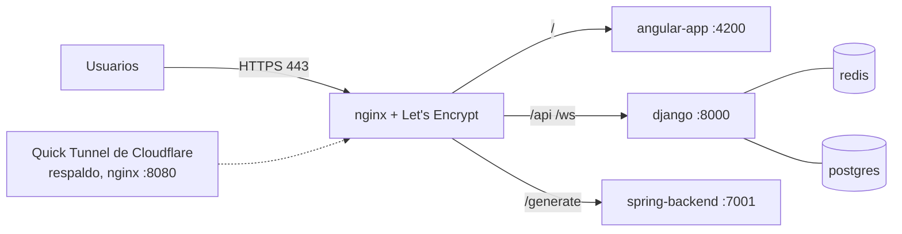

# Despliegue en AWS (EC2) con dominio y HTTPS

Estado verificado el **2026-10-21**. Sitio: **https://diagramador.dev**

## 1. Resumen

Todo corre en **una instancia EC2** (Ubuntu 24.04, 2 vCPU, ~2 GB de RAM) con Docker Compose. **nginx** recibe el tráfico en los puertos 80/443, termina HTTPS (certificado de Let's Encrypt) y reparte hacia los servicios. El dominio lo gestiona name.com (registro `A` hacia la IP pública de la instancia).



El frontend decide sus direcciones al abrirse la página (`front_generador_bd/src/environments/environment.ts`): con HTTPS usa el mismo origen (`/api`, `/ws`, `/generate`), con HTTP directo (solo en local, donde esos puertos están publicados) usa los puertos 8000 y 7001. Por eso un mismo build sirve para el dominio, el túnel y el acceso directo.

## 2. Componentes

| Servicio | Contenedor | Puerto interno | Notas |
|---|---|---|---|
| Frontend Angular SSR | `angular_frontend` | 4000 (publicado como 4200) | Imagen construida desde `front_generador_bd/Dockerfile` |
| API + WebSockets | `django_backend_UML` | 8000 | Django 5, Channels, Daphne |
| Generador | `spring_backend` | 7001 | Spring Boot 3.5, Java 21 |
| Redis | `redis_server` | 6379 | Capa de canales y roles de sala |
| PostgreSQL | `postgres_db` | 5432 (publicado como 5433) | Respaldo de diagramas |
| pgAdmin | `pgadmin` | 80 (publicado como 5050) | Solo administración |

Todos los contenedores tienen política de reinicio `unless-stopped`; Docker y nginx arrancan con la máquina.

## 3. Configuración (nombres de variables, nunca valores)

- `back_generador_bd/.env` (no versionado): `DJANGO_SECRET_KEY`, `DEBUG` (**debe ser `False`**), `DJANGO_ALLOWED_HOSTS`, `CORS_ALLOWED_ORIGINS`, `CSRF_TRUSTED_ORIGINS`, `POSTGRES_*`, `REDIS_*`, `GEMINI_API_KEY`, `GEMINI_MODEL`. El dominio nuevo debe agregarse a las tres listas.
- `.env` en la raíz del repositorio (no versionado): `APP_CORS_ALLOWED_ORIGINS`, orígenes extra separados por comas que Spring **suma** a los suyos (ver `SecurityConfiguration`). Se pasa al contenedor desde `docker-compose.app.yml`.
- Los archivos `.env` nunca se suben a git.

## 4. Desplegar un cambio

El servidor usa `docker-compose` (binario independiente), no `docker compose`. Se actualiza **un servicio a la vez** para no cortar el resto:

1. Respaldar la imagen actual por su identificador (`docker tag <id> <imagen>:antes-<fecha>`).
2. Traer el código: `git pull --ff-only <url-del-repositorio> develop` (si hay ediciones sin guardar, se detiene).
3. Reconstruir solo ese servicio: `docker-compose -f docker-compose.app.yml build <servicio>` (`angular-app` o `spring-backend`). Los contenedores actuales siguen funcionando durante el build.
4. Comprobar que la imagen cambió y reiniciar solo ese servicio: `docker-compose -f docker-compose.app.yml up -d --no-deps <servicio>`.
5. Pruebas de humo (sección 6).

Una instancia pequeña puede tardar varios minutos construyendo el frontend; conviene hacerlo sin usuarios conectados.

### Volver atrás

```bash
docker tag <id-imagen-anterior> <imagen>:latest
docker-compose -f docker-compose.app.yml up -d --no-deps --no-build <servicio>
```

Para el `.env` de Django, restaurar la copia `.env.bak-<fecha>` y recrear el servicio con `up -d --no-deps --force-recreate django`.

## 5. Dominio y HTTPS

1. Dominio registrado en name.com (oferta de GitHub Student Developer Pack, primer año gratis). **La renovación automática está apagada: vence el 2027-10-21** y hay que renovarlo a mano o cambiar de nombre antes.
2. Registro `A` (host vacío) hacia la IP pública de la instancia, TTL 300.
3. Sitio nginx propio para el dominio en el puerto 80 con el mismo reparto de rutas que el del túnel (`/api/`, `/ws/` con Upgrade, `/generate`, `/`).
4. Certificado: `sudo certbot --nginx -d <dominio> --redirect -m <correo> --agree-tos --no-eff-email --non-interactive`. Certbot agrega el servidor 443 y la redirección 301. La renovación la hace el temporizador `certbot.timer`.
5. Si la IP pública de la instancia puede cambiar (apagado y encendido), asignar una IP elástica.

## 6. Pruebas de humo

**Un solo comando:** `scripts/smoke-test.sh [dominio]` ejecuta todas las comprobaciones siguientes (más el cierre de los puertos 4200, 7001 y 8000) y termina con código 0 si todo está bien. Solo lee, no modifica nada. Última corrida: 2026-10-22, todo en orden.

Desde cualquier equipo, sustituyendo el dominio:

```bash
curl -s -o /dev/null -w '%{http_code}\n' https://<dominio>/                       # 200
curl -s -w ' %{http_code}\n' https://<dominio>/api/get_backup_uml/00000000-0000-0000-0000-000000000000/   # JSON de error, 404
curl -s -o /dev/null -w '%{http_code}\n' http://<dominio>/                         # 301 hacia https
curl -s -X POST https://<dominio>/generate -H 'Content-Type: application/json' \
  --data '{"classes":[{"id":"c1","name":"Persona","attributes":[{"name":"id","type":"int"}],"methods":[]}],"relationships":[]}' \
  -o /tmp/prueba.zip -w '%{http_code}\n'                                           # 200 y un ZIP
```

WebSocket: una petición HTTP/1.1 con `Upgrade: websocket` a `/ws/canvas/<sala>/` debe responder `101 Switching Protocols`.

## 7. Seguridad y estado conocido

- `DEBUG=False` en Django. Los secretos viven en archivos `.env` fuera de git.
- El grupo de seguridad deja abiertos **solo 22, 80 y 443** (los puertos directos 4200, 7001 y 8000 se cerraron el 2026-10-21; todo entra por nginx). **Pendiente recomendado:** limitar el 22 a la IP del administrador (riesgo: si esa IP cambia, hay que editar la regla desde la consola de AWS).
- Redis, PostgreSQL y pgAdmin están publicados en el host (6379, 5433, 5050) pero el grupo de seguridad no los abre al exterior. No abrirlos.
- **Modelo de acceso (decisión de diseño, RF-17):** no hay cuentas; el **código de la sala es la capacidad**. Quien lo conoce puede editar, expulsar (si es host) y leer el historial y la actividad de esa sala. La vista móvil de seguimiento (`/sala/<id>/seguir`) es de **solo lectura por diseño de la interfaz y del servidor para esa conexión**, pero **no es un límite de seguridad**: el enlace contiene el mismo código y quien lo recibe puede abrir la sala como editor. Si algún día hiciera falta separar permisos habría que emitir códigos distintos de lectura y de edición.
- **Atribución a la IA:** las operaciones marcadas `via_ia` las envía el navegador de quien pidió el cambio; el servidor las registra como "IA, a pedido de X" pero no puede demostrar que vengan de una respuesta real de la IA. Es un registro de transparencia, no una auditoría a prueba de manipulación.
- **Costo de la IA:** el servidor limita los pedidos por participante (12/min), por sala (30/min) y en total (60/min), y cada conexión puede cambiar de identidad como máximo 5 veces. El tope global y el de sala no dependen de identificadores elegidos por el cliente.
- **Cambios de la IA:** el servidor rechaza cambios enormes y la interfaz pide confirmación antes de aplicar uno que elimina elementos (el modelo lee el contenido del diagrama, que puede venir de una importación).
- No hay CI/CD ni infraestructura como código: el despliegue es manual y repetible con los pasos de la sección 4.
- El **Quick Tunnel de Cloudflare** sigue como respaldo, pero es un proceso manual (no un servicio) y su dirección cambia si se reinicia. Si cambia, agregarla a `APP_CORS_ALLOWED_ORIGINS` y reiniciar Spring.
