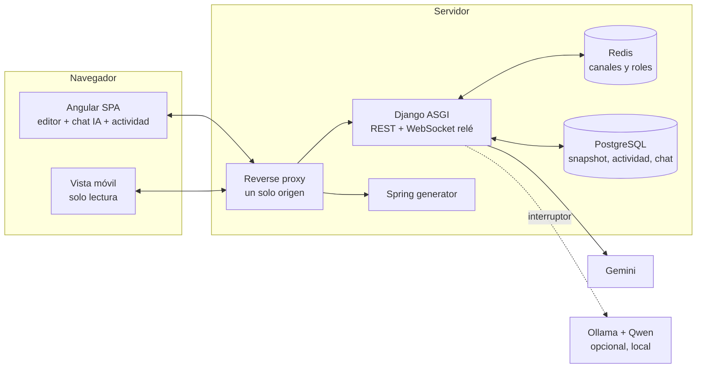
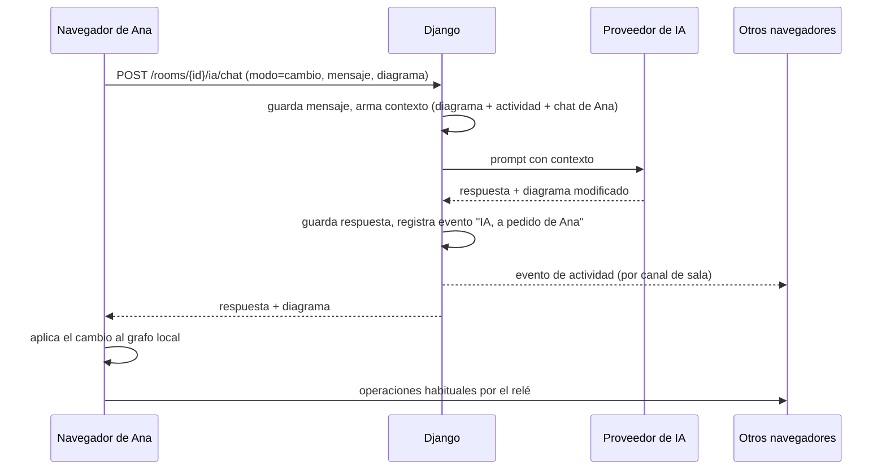
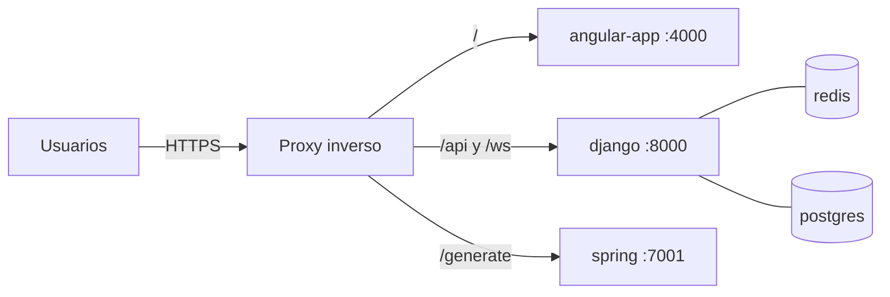

# Plan de trabajo PUDS — Diagramador UML con IA participante

| | |
|---|---|
| **Proyecto** | Plataforma CASE de modelado UML (Ing. de Software I) |
| **Cambio que cubre este plan** | La IA pasa a ser un participante más de la pizarra colaborativa (requerimiento del docente, clase del 2026-10-13) |
| **Repositorio** | https://github.com/Gris999/Diagramador_UML_Examen2 (público, rama por defecto `develop`) |
| **Origen (baseline)** | https://github.com/Fournext/Diagramador_UML_Examen2, tag `baseline-fournext` |
| **Línea base de este plan** | `develop` @ `4319942` (2026-09-29) + trabajo en staging sin commit (entidad intermedia M:N) |
| **Fecha del plan** | 2026-10-14 |
| **Versión / estado** | 0.1 — borrador para revisión |
| **Fecha de entrega** | **Por confirmar con el docente.** Las duraciones de abajo son relativas, no fechas |

> **Cómo leer este documento.** Lo marcado *(verificado)* se comprobó leyendo el código el 2026-10-14. Lo marcado *(propuesta)* es una decisión de diseño que aún no existe. Las estimaciones de esfuerzo son iniciales, para una sola persona que ya conoce el código, y hay que revisarlas al cerrar cada iteración.

---

## 1. Resumen

El docente pidió dos cosas para la evaluación:

1. Que **todo lo del primer parcial funcione completo**, sin que falte nada.
2. Que **la IA sea un desarrollador más** de la sala: no hace nada hasta que alguien se lo pide, sus ideas se ven, conoce el contexto de todos, registra quién hace qué, y hay sesiones continuas y una versión móvil para quien viaja.

Este plan cierra primero la línea base (I0) y después construye la IA participante en iteraciones cortas (I1–I6), terminando con endurecimiento, despliegue y entrega (I7).

**Decisión de diseño de Pedro (2026-10-14):** cada persona tiene su propio chat con la IA. Hay un registro de actividad visible para todos, y la IA usa ese registro para saber qué hizo cada integrante. Las acciones son públicas; el texto de los chats es privado.

---

## 2. Contexto y línea base

### 2.1 Componentes actuales *(verificado)*

| Componente | Tecnología | Puerto | Función |
|---|---|---|---|
| `front_generador_bd` | Angular 20 (SSR), JointJS, Tailwind | 4200 → 4000 | Editor UML, colaboración, exportaciones, IA |
| `back_generador_bd` | Django 5, DRF, Channels, Daphne | 8000 | API, WebSockets, Gemini, XMI, generador Flutter |
| `back_generator_uml` | Spring Boot 3.5, Java 21 | 7001 | Generador de proyectos Spring + Postman |
| Redis 7 | — | 6379 | Capa de canales (Channels) y roles de sala |
| PostgreSQL 17 | — | 5433 → 5432 | Respaldo de diagramas |

### 2.2 Hallazgos de la revisión del código *(verificado)*

| # | Hallazgo | Consecuencia para el plan |
|---|---|---|
| H1 | La IA no tiene memoria: `POST /api/chatbot/` recibe el prompt y el diagrama actual, nada más (`views.py`, `services_gemini.py`). | Hay que construir el contexto compartido (I2). |
| H2 | No hay identidad: el panel muestra "Usuario 1, 2…" según el orden de conexión; los peers son `channel_name` temporales. | Nombre visible + token (I1). |
| H3 | Los cambios del diagrama viajan por el **WebSocket de Django como relé** (`p2p.service.ts` → `sendToAll` → `signaling.broadcast`). Las conexiones WebRTC se preparan, pero los datos no van por ahí. El servidor reenvía sin guardar el estado vivo. | El servidor puede registrar la actividad sin tocar los clientes (I1). |
| H4 | La persistencia es una foto JSON por sala (`BackupUML`). No hay historial de actividad ni de chat. | Modelos nuevos (I1, I2, I4). |
| H5 | No hay cuentas ni autenticación en el backend. Los roles viven solo en la sala (RF-12…RF-17). | La identidad será un token anónimo (ver riesgo R4). |
| H6 | Existe una revisión por IA (`/ws/uml/`, `validate_model`), pero solo evalúa relaciones y responde solo a quien la pidió. | Ampliarla y publicarla (I3). |
| H7 | No existe vista móvil de seguimiento. Las apps Flutter generadas son CRUD del sistema modelado, otra cosa. | Vista de solo lectura (I5). |
| H8 | `back_generador_bd/docker-compose.yml` tiene una **contraseña de Postgres escrita en el archivo, versionada desde el primer commit del baseline (2025-10-20), en un repositorio público**. | Quitarla y rotarla (I0). |
| H9 | `environment.ts` apunta a `django-sw1.fournext.me` y `spring-sw1.fournext.me`, dominios que **hoy no resuelven** (comprobado el 2026-10-14). El sitio desplegado en el túnel llama a Django en el mismo origen (`endpoint_python:"/"`), lo que difiere de lo que hay en el repositorio. | Fijar los endpoints en el repositorio y rehacer el build desplegado (I0, I7). |
| H10 | `docker-compose.app.yml` ejecuta `makemigrations` al arrancar, monta el código como volumen y publica Redis (6379), Postgres (5433) y pgAdmin (5050) hacia afuera. Es una configuración de desarrollo. | Compose de producción (I7). |
| H11 | No hay CI: `.github/` solo contiene hooks de `modernize`. | Pipeline en I7. |
| H12 | `develop` tiene 1 commit sin subir (`4319942`) y 13 archivos en staging sin commit. GitHub registra el último push el 2026-09-22. | Cerrar en I0. |

---

## 3. Alcance

### 3.1 Incluido
- Identidad de participante (nombre + token), IA visible como participante.
- Registro de actividad compartido.
- Chat individual con la IA, con contexto de todo el equipo.
- Modos explícitos *Preguntar / Revisar* y *Pedir cambio*; sugerencias aplicables.
- Revisión por IA de clases, atributos, métodos y relaciones.
- Sesiones continuas (diagrama, actividad y chat propio se recuperan).
- Vista móvil de seguimiento de solo lectura.
- Despliegue reproducible y documentación PUDS.

### 3.2 Opcional (se valora, no es obligatorio)
- Proveedor de IA local (Ollama con un modelo Qwen) conmutable por configuración.

### 3.3 Fuera de alcance
- Cuentas de usuario con login, permisos persistentes, edición desde móvil, entrenamiento de modelos, despliegue gestionado en AWS (solo se documenta).

### 3.4 Decisiones

| ID | Decisión | Estado |
|---|---|---|
| D-01 | Chat por persona + registro de actividad compartido | **Tomada** (Pedro) |
| D-02 | La IA actúa a través del navegador de quien la invoca; sus cambios se etiquetan "IA" | **Tomada** |
| D-03 | Modos explícitos *Preguntar* y *Pedir cambio* para garantizar que la IA no actúe sin orden | Propuesta |
| D-04 | Vista móvil = ruta de solo lectura en la misma app Angular (responsive) | Propuesta |
| D-05 | IA local opcional, con Ollama + Qwen, detrás de un interruptor | Propuesta (el audio no lo menciona; lo recuerda Pedro) |
| D-06 | Fecha de entrega y formato de los artefactos PUDS | **Pendiente** (docente) |
| D-07 | Confirmar chat por persona vs. compartido | Opcional (docente) |

---

## 4. Requisitos nuevos

Se agregan a `docs/REQUIREMENTS.md` en I0.

| ID | Requisito |
|---|---|
| RF-23 | Cada participante tiene un nombre visible y un identificador anónimo guardado en su navegador. |
| RF-24 | La IA aparece como participante en el panel de participantes. |
| RF-25 | Existe un registro de actividad por sala, visible para todos, con autor, tipo y resumen de cada acción. |
| RF-26 | Cada participante tiene un chat individual con la IA. Ningún otro participante puede leerlo. |
| RF-27 | La IA responde sobre la actividad de cualquier integrante usando el registro. |
| RF-28 | La IA solo modifica el diagrama cuando un participante lo ordena explícitamente. Sus ideas se muestran como sugerencias que cualquiera puede aplicar. |
| RF-29 | Los cambios de la IA se aplican y se propagan a todos, etiquetados como "IA, a pedido de X". |
| RF-30 | A pedido, la IA revisa clases, atributos, métodos y relaciones. |
| RF-31 | Al volver a una sala se recuperan el diagrama, el registro de actividad y el chat propio. |
| RF-32 | Existe una vista móvil de seguimiento en vivo, de solo lectura. |
| RF-33 | *(Opcional)* El proveedor de IA es configurable: Gemini o local (Ollama/Qwen). |
| RNF-04 | Privacidad: el chat de una persona no es accesible por otras. |
| RNF-05 | Resiliencia: si la IA falla, se muestra un mensaje claro y el diagrama no se pierde ni se corrompe. |
| RNF-06 | El registro no degrada la edición: no se registran acciones continuas como mover o redimensionar. |
| RNF-07 | El despliegue es reproducible con un solo comando y tiene prueba de humo. |

---

## 5. Enfoque metodológico: PUDS

PUDS se basa en el Proceso Unificado. *(Los nombres de los artefactos se ajustan a la plantilla del docente cuando la confirme.)*

**Principios que se aplican:** dirigido por casos de uso, centrado en la arquitectura, iterativo e incremental, y controlado por riesgos (los riesgos más altos se atacan en las primeras iteraciones).

### 5.1 Fases e iteraciones

| Fase | Objetivo en este proyecto | Iteraciones | Hito de salida |
|---|---|---|---|
| **Inicio** | Alinear alcance y cerrar la línea base | I0 | Alcance acordado, `develop` limpio, tests de la base en verde |
| **Elaboración** | Validar la arquitectura con un caso de uso de punta a punta | I1 | Prototipo vertical: nombre → acción → registro visible en todos |
| **Construcción** | Completar las funciones | I2, I3, I4, I5, I6 | Todas las funciones RF-23…RF-33 implementadas y probadas |
| **Transición** | Entregar | I7 | Sistema desplegado, documentación final, demo ensayada |

### 5.2 Flujos de trabajo y artefactos

| Flujo | Artefactos de este plan |
|---|---|
| Requisitos | Lista de RF/RNF (§4), modelo de casos de uso (§7), glosario |
| Análisis | Clases de análisis (Participante, EventoActividad, MensajeChat, Sugerencia), diagrama de robustez de CU-04 |
| Diseño | Arquitectura (§6), modelo de datos, contratos WS/REST, diagramas de secuencia |
| Implementación | Ramas por iteración (§10), código y migraciones |
| Pruebas | Estrategia (§9), casos de prueba por CU, evidencias |
| Despliegue | Plan y procedimiento (§11) |
| Apoyo | Gestión de riesgos (§12), gestión de configuración (§10), `GAP_MATRIX.md` como tablero |

---

## 6. Arquitectura

### 6.1 Estilo *(propuesta, sobre lo existente)*

- **Cliente–servidor en tres servicios** (SPA Angular con SSR, API Django ASGI, generador Spring). No se reescribe nada.
- **Replicación por operaciones:** cada navegador mantiene su copia del grafo JointJS y se pasan operaciones por un relé WebSocket (Redis como capa de canales).
- **Registro de eventos en el servidor** (nuevo): el relé ya ve todas las operaciones, así que registra las significativas.
- **IA detrás de una interfaz de proveedor** (patrón Strategy/Adapter): `GeminiProvider` hoy, `OllamaProvider` opcional.
- **Contexto compuesto por solicitud:** diagrama + registro reciente + chat propio del solicitante.

### 6.2 Vista de componentes (objetivo)

### 6.3 Secuencia: "Pedir cambio" a la IA

### 6.4 Modelo de datos nuevo *(propuesta)*

| Entidad | Campos principales |
|---|---|
| `Participant` | `room_id`, `token` (UUID, secreto), `display_name`, `created_at`, `last_seen`; único `(room_id, token)` |
| `ActivityEvent` | `room_id`, `actor_kind` (`user` / `ia`), `actor` → Participant, `requested_by` → Participant (nulo), `type`, `target_id`, `summary`, `data` (JSON), `created_at`; índice `(room_id, created_at)` |
| `ChatMessage` | `room_id`, `participant`, `role` (`user` / `ia`), `content`, `visibility` (siempre `private` por ahora), `created_at` |
| `BackupUML` | Existente: se mantiene sin cambios |

### 6.5 Contratos *(propuesta)*

**WebSocket `/ws/canvas/<sala>/`** (se amplía, sin romper lo existente):
- Cliente → servidor: `{type:"hello", token, name, mode:"editor"|"viewer"}`.
- Servidor → clientes: el mensaje `presence/state` incluye `name` y `kind` (`user`, `viewer`, `ia`).
- Los `viewer` no entran al orden que define al host (RF-12).

**REST** (cabecera `X-Participant-Token` para lo privado):

| Método y ruta | Uso |
|---|---|
| `GET /api/rooms/{id}/activity/?since=` | Registro de actividad de la sala |
| `GET /api/rooms/{id}/chat/` | Chat propio del solicitante |
| `POST /api/rooms/{id}/ia/chat/` | Mensaje a la IA: `{mode:"ask"\|"review"\|"change", message, uml}` → `{reply, uml?, suggestions?}` |

### 6.6 Decisiones de arquitectura

| ID | Decisión | Razón | Alternativa descartada |
|---|---|---|---|
| ADR-01 | La IA aplica sus cambios a través del navegador de quien la invoca | El estado vivo del diagrama está en los clientes; siempre hay una persona que ordenó el cambio | IA como participante del lado del servidor: exigiría una copia del diagrama en el servidor |
| ADR-02 | Registrar actividad en el consumer del relé, con lista blanca de operaciones | El relé ya ve todo; no hay que tocar los clientes para registrar | Registrar desde cada cliente: duplica lógica y se puede olvidar |
| ADR-03 | Modos explícitos *Preguntar / Pedir cambio* | Garantiza de forma verificable que la IA no actúa sin orden | Que el modelo decida solo si actuar: no es verificable |
| ADR-04 | Token anónimo en el navegador | No hay cuentas (RF-17); permite recuperar el chat | Login: fuera de alcance |
| ADR-05 | Interfaz `AIProvider` | Permite IA local sin tocar la interfaz de usuario | Llamar a Gemini directamente |
| ADR-06 | Un solo origen detrás de un proxy (`/`, `/api`, `/ws`, `/generate`) | Evita CORS y coincide con el cambio del commit `4319942` | Tres orígenes publicados |

---

## 7. Casos de uso

| ID | Caso de uso | Actor |
|---|---|---|
| CU-01 | Identificarse al entrar a una sala | Participante |
| CU-02 | Ver la actividad del equipo | Participante |
| CU-03 | Preguntar a la IA (incluye "¿qué hizo X?") | Participante |
| CU-04 | Pedirle a la IA un cambio en el diagrama | Participante |
| CU-05 | Pedirle a la IA una revisión | Participante |
| CU-06 | Ver las ideas de la IA y aplicar una | Participante |
| CU-07 | Retomar una sesión anterior | Participante |
| CU-08 | Seguir la sala desde el móvil | Observador |
| CU-09 | Configurar el proveedor de IA | Administrador |

---

## 8. Plan de iteraciones

Esfuerzo en horas para una persona. La suma sin I6 es de unas **78–110 h**; con I6, de unas **86–122 h**. La definición de terminado está en §13.

### I0 — Cierre de la línea base *(Inicio)* · 6–10 h · rama `chore/cierre-base`

| # | Tarea |
|---|---|
| 1 | Ejecutar las suites (§9) y registrar el resultado real. |
| 2 | Revisar el trabajo en staging (M:N), correr sus tests y hacer commit en `feat/junction-entity`. |
| 3 | Subir `develop` (1 commit pendiente) y limpiar los 5 worktrees ya mergeados y el worktree roto de `/private/tmp`. |
| 4 | **Quitar la contraseña de `back_generador_bd/docker-compose.yml`** (usar `env_file`) y cambiarla si se reutiliza en otro sitio. |
| 5 | Confirmar que los dominios de `environment.ts` son tuyos o apuntar a los propios. |
| 6 | Añadir RF-23…RF-33 a `REQUIREMENTS.md` y filas a `GAP_MATRIX.md`. |
| 7 | Cerrar con el docente: fecha de entrega, plantilla PUDS, chat por persona (opcional), IA local. |

**Criterio de salida:** `develop` sin cambios pendientes, tests de la base en verde, requisitos nuevos escritos.

### I1 — Identidad y registro de actividad *(Elaboración, prototipo vertical)* · 12–16 h · `feat/identidad-actividad`

| Capa | Tarea |
|---|---|
| Front | `identity.service.ts`: pide el nombre al entrar, guarda el token en `localStorage`. Enviar `hello`. `participants-panel`: mostrar nombres y la fila "IA". Componente `activity-panel`. |
| Back | `collab/consumers.py`: manejar `hello`, incluir `name` en `presence/state`; registrar `add_class`, `delete`, `add_link`, `edit_text` (con agrupación) y no registrar `move`, `resize`, `update_vertices`, `move_label`. Modelos `Participant` y `ActivityEvent` con migración. `GET /activity/`. |

**Aceptación:** tres clientes con nombre; la acción de uno aparece en el registro de todos con su nombre; mover y redimensionar no generan eventos; tras recargar se conserva el nombre.
**Pruebas:** `WebsocketCommunicator` (hello, presencia, lista blanca), pruebas de modelos, specs de `identity.service` y `activity-panel`.

### I2 — Chat individual con contexto *(Construcción)* · 14–18 h · `feat/ia-chat`

| Capa | Tarea |
|---|---|
| Back | `ChatMessage`. `uml_api/services/ai_provider.py` con `AIProvider` y `GeminiProvider`. `uml_api/services/ia_context.py`: arma el prompt con rol, diagrama, últimos N eventos y últimos M mensajes del solicitante. `POST /ia/chat/` en modos `ask`. `GET /chat/` filtrado por token. |
| Front | `ia-chat.service.ts` y panel de chat (historial, entrada de texto, voz reutilizando el micrófono actual). |

**Aceptación:** Ana pregunta "¿qué hizo Beto?" y la respuesta coincide con el registro; Beto no puede leer el chat de Ana (403/404 en pruebas); el prompt nunca incluye mensajes de chat de otras personas.
**Pruebas:** proveedor falso con respuestas fijas, pruebas de construcción de contexto y de privacidad, specs del panel.

### I3 — Acciones, sugerencias y revisión *(Construcción)* · 14–20 h · `feat/ia-acciones`

| Tarea |
|---|
| Modo *Pedir cambio*: reutiliza el flujo actual (`call_gemini` → aplicar en el grafo), y el servidor registra el evento "IA, a pedido de X" y lo difunde a la sala. |
| Sugerencias: la respuesta puede traer `suggestions[]`; panel "Ideas de la IA" con botón *Aplicar* (queda a nombre de quien aplica). |
| Revisión: ampliar `validate_model` a atributos, métodos y relaciones; publicar el resultado como evento visible a todos. |
| Marca visual de la IA: entrada fija en participantes, estado "pensando…", resaltado breve de las clases que tocó. |

**Aceptación:** en modo *Preguntar/Revisar* el diagrama nunca cambia (prueba automática con un proveedor falso que devuelve un diagrama); un cambio de la IA aparece en todas las pantallas y en el registro con la etiqueta correcta.

### I4 — Sesiones continuas *(Construcción)* · 8–12 h · `feat/sesiones-continuas`

| Tarea |
|---|
| Al entrar: cargar snapshot (`get_backup_uml`), últimos eventos y el chat propio. |
| Guardado automático del snapshot con retardo (hoy depende de un guardado explícito) y al salir el último participante. |
| "Retomar como *nombre*" cuando existe un token. Resumen automático de sesión si el registro es muy largo (opcional). |

**Aceptación:** se cierran todas las pestañas, se vuelve al día siguiente y están el diagrama, la actividad y el chat propio; un navegador sin token ve el diagrama y la actividad, pero no los chats ajenos.

### I5 — Vista móvil de seguimiento *(Construcción)* · 10–14 h · `feat/vista-movil`

| Tarea |
|---|
| Ruta `/sala/:id/seguir` en modo `viewer`: solo recibe operaciones, no envía ninguna. |
| Servidor: los `viewer` no cuentan para el rol de host y no pueden ser expulsados ni expulsar. |
| Diseño responsive (diagrama con zoom y arrastre, feed de actividad debajo). |
| Opcional: PWA instalable. |

**Aceptación:** en un móvil se ve el diagrama actualizándose en vivo y la actividad; no hay ningún control de edición; un viewer que entra primero no se convierte en host.

### I6 — IA local *(opcional)* · 8–12 h · `feat/ia-local`

| Tarea |
|---|
| `OllamaProvider` (API HTTP local), variables `AI_PROVIDER`, `OLLAMA_BASE_URL`, `OLLAMA_MODEL`. |
| Indicador en la interfaz: "IA: local (modelo)" o "IA: nube (Gemini)". Reintento hacia Gemini si el modelo local falla (configurable). |
| Evaluación: 10 pedidos fijos contra Gemini y contra el modelo local; registrar tasa de JSON válido y de resultado correcto. |
| Guía de instalación (Ollama + `qwen2.5` de 7–8 B en un Mac con 16 GB). |

**Aceptación:** con `AI_PROVIDER=ollama` el chat funciona sin internet y la evaluación queda documentada, aunque el modelo local falle más que Gemini.

### I7 — Endurecimiento, despliegue y entrega *(Transición)* · 14–20 h · `release/entrega`

| Tarea |
|---|
| Despliegue (§11), CI, prueba de humo. |
| Revisar cobertura de lo crítico (§9) y cerrar las filas `PARTIAL` de la matriz. |
| Documentación final: este plan actualizado, arquitectura, manual de usuario, evidencias de prueba. |
| Guion y ensayo de la demostración (§13). Tag `v1.0`. |

---

## 9. Estrategia de pruebas

| Nivel | Qué cubre | Herramienta / comando |
|---|---|---|
| Unidad (Django) | Contexto de IA, modelos, privacidad, proveedores | `back_generador_bd/.venv/bin/python back_generador_bd/manage.py test <etiqueta>` |
| Integración (Django + Redis + Postgres) | Consumers, REST con base de datos | `docker exec django_backend_UML python manage.py test` |
| Unidad (Angular) | Servicios y componentes nuevos | `ng test` (Karma/Jasmine) |
| Spring | Generación y compilación | `./mvnw test` en `back_generator_uml` |
| Contrato de IA | Proveedor falso; la IA real (Gemini/Ollama) no se invoca en CI | Pruebas con respuestas fijas |
| Aceptación manual | 3 clientes reales, móvil físico, IA real | Lista de verificación como la que ya usa `GAP_MATRIX.md` |

**Reglas**
- Cada CU tiene al menos un caso de aceptación con pasos y resultado esperado.
- Las pruebas críticas de AGENTS.md (colaboración, permisos, reconexión, generadores) se vuelven a ejecutar al final de cada iteración como regresión.
- No se da una tarea por terminada sin que compile, pase sus pruebas y no incluya secretos.
- Estado actual de la cobertura: 16 specs en Angular, 9 archivos de prueba en Django, 2 en Spring. **No se corrieron en la revisión del 2026-10-14**; en I0 se registra el resultado real.

---

## 10. Gestión de configuración y ramas

- `main` = baseline del origen; `develop` = integración; trabajo en ramas `feat/*`, `fix/*`, `docs/*` (reglas de `AGENTS.md`).
- Un worktree por rama activa y **un solo responsable por rama**.
- Commits pequeños con un propósito, formato `tipo: descripción`. Hook de pre-commit existente (GGA).
- Integración a `develop` con merge solo cuando compila y pasan las pruebas relevantes.
- Tags de hito: `hito-1-base`, `hito-2-arquitectura`, `hito-3-funciones`, `v1.0`.
- Nunca se versionan `.env`, claves, `node_modules`, `.venv` ni artefactos de build.

---

## 11. Despliegue

### 11.1 Estado actual *(verificado)*
Docker Compose en dos archivos (`docker-compose.db.yml` con Postgres y pgAdmin; `docker-compose.app.yml` con Django, Redis, Spring y Angular). La red `backend` es externa y hay que crearla antes. Hubo un despliegue manual en EC2 y un túnel de Cloudflare para demostración. No hay CI ni infraestructura como código.

**Sitio desplegado hoy** *(comprobado el 2026-10-14 con peticiones HTTP; no se probó la generación de backend ni la IA en esas URLs)*:

| URL | Estado | Observación |
|---|---|---|
| https://spectrum-opinion-yeast-permanent.trycloudflare.com/ | Responde 200; sirve la app Angular y Django en el mismo origen | Es un *Quick Tunnel* de Cloudflare: la dirección **desaparece cuando se detiene el proceso `cloudflared`** y cambia al reiniciarlo. No está instalado en el Mac de Pedro, así que corre en otra máquina |
| http://18.188.167.127:4200/ | Responde 200; Angular en el puerto 4200 (Django en el 8000) | Parece ser la instancia EC2, sin HTTPS ni dominio |
| `front-sw1`, `django-sw1`, `spring-sw1` en `fournext.me` | No resuelven (DNS) | Dominios del equipo original, fuera de uso |
| Hosts `ec2-3-84-241-46…` y `ec2-34-228-19-253…` | Sin respuesta | Instancias antiguas |

### 11.2 Opciones

| Opción | Descripción | Esfuerzo | Uso |
|---|---|---|---|
| **A. Una máquina virtual con Docker Compose y proxy con TLS** | Una instancia (por ejemplo EC2) con `compose.prod` y un proxy inverso | Medio | **Recomendada para la entrega** |
| B. Túnel de Cloudflare desde tu equipo | Rápida, ya probada | Bajo | Respaldo para la demo |
| C. AWS gestionado (ECS, RDS, ElastiCache, ALB) | Servicios gestionados | Alto | Solo documentar si el curso lo exige (RNF-02) |

### 11.3 Topología recomendada (opción A)

Redis y Postgres quedan en una red interna, **sin puertos publicados**.

### 11.4 Cambios al compose para producción

| Cambio | Motivo |
|---|---|
| Archivo `docker-compose.prod.yml` separado del de desarrollo | No mezclar configuraciones |
| Quitar `makemigrations` del arranque; aplicar solo `migrate` y versionar las migraciones | Evita generar migraciones en producción |
| Quitar el volumen que monta el código | La imagen debe ser autosuficiente |
| No publicar Redis, Postgres ni pgAdmin (o dejar pgAdmin solo local) | Reduce la superficie expuesta |
| Fijar versiones de imágenes (pgAdmin está en `latest`) y usar `npm ci` | Builds reproducibles |
| `restart: unless-stopped` y *healthchecks* en todos los servicios | Recuperación automática |
| `DEBUG=False`, hosts y orígenes permitidos por entorno | Seguridad |
| Red creada por el propio compose (sin `external`) | Un comando levanta todo |

### 11.5 Variables de entorno (solo nombres; nunca valores en el repositorio)
`DJANGO_SECRET_KEY`, `DEBUG`, `DJANGO_ALLOWED_HOSTS`, `CORS_ALLOWED_ORIGINS`, `CSRF_TRUSTED_ORIGINS`, `POSTGRES_DB`, `POSTGRES_USER`, `POSTGRES_PASSWORD`, `POSTGRES_HOST`, `POSTGRES_PORT`, `REDIS_HOST`, `REDIS_PORT`, `GEMINI_API_KEY`, `GEMINI_MODEL`, y las nuevas `AI_PROVIDER`, `OLLAMA_BASE_URL`, `OLLAMA_MODEL`.

### 11.6 Procedimiento
1. Preparar la máquina: Docker, dominio o túnel, certificado (lo gestiona el proxy).
2. Copiar `.env` de producción (fuera de git) con claves nuevas.
3. `docker compose -f docker-compose.prod.yml up -d --build`.
4. Aplicar migraciones y comprobar el estado de los servicios.
5. **Prueba de humo:** abrir la web; entrar a una sala con dos navegadores; crear una clase y ver que aparece en el otro; pedir algo a la IA; generar backend y Flutter; abrir la vista móvil.
6. **Reversa:** conservar la imagen y el tag anteriores; volver con `up -d` sobre el tag previo; restaurar el volcado de Postgres si hubo migración.

### 11.7 CI/CD *(propuesta, I7)*
GitHub Actions: en cada PR, pruebas de Django (con servicios Postgres y Redis), pruebas de Angular y de Spring; en `develop`, construcción de imágenes; despliegue por SSH solo con aprobación manual.

### 11.8 Datos y observabilidad
Volcado diario de Postgres (`pg_dump`) con retención; registros de contenedores; la prueba de humo del paso 5 como verificación después de cada despliegue.

### 11.9 La IA local en el despliegue
Un modelo local no es práctico en una máquina virtual pequeña sin GPU. En producción se usa Gemini; el modelo local queda para la demostración en el equipo de Pedro (el contenedor de Django llega a Ollama por `host.docker.internal`).

---

## 12. Riesgos

| ID | Riesgo | Prob. | Impacto | Mitigación |
|---|---|---|---|---|
| R1 | La fecha de entrega llega antes de terminar | Media | Alto | Orden por valor: I0→I1→I2→I3 cubren el núcleo; I5 e I6 se recortan primero |
| R2 | Algo del primer parcial está roto y no se detecta | Media | Alto | Ejecutar todas las suites en I0 y como regresión en cada iteración |
| R3 | El docente quiere un chat compartido | Media | Medio | Se guardan autor y visibilidad desde el inicio; el cambio es filtrar, no rehacer |
| R4 | El token anónimo choca con RF-16/RF-17 ("sin propiedad persistente") | Media | Bajo | Documentar que el token solo recupera el chat; los roles siguen siendo efímeros |
| R5 | La IA devuelve JSON inválido o modifica de más | Alta | Medio | Validación existente, modos explícitos, pruebas con proveedor falso, mensaje claro (RNF-05) |
| R6 | Cuota o caída de Gemini durante la demo | Media | Alto | Reintento y modelo alterno ya existentes; IA local como respaldo; demo grabada |
| R7 | El registro hace lenta la edición | Baja | Medio | Lista blanca, agrupar ediciones de texto, escritura asíncrona |
| R8 | Credencial ya expuesta en el repositorio público | Alta (ya ocurrió) | Medio | Quitarla del archivo y cambiarla (I0) |
| R9 | Los dominios `fournext.me` ya no resuelven y el sitio desplegado depende de un túnel temporal | Alta (ya ocurrió) | Alto | Endpoints por variable de entorno; dominio propio o IP fija en I7 |
| R10 | Un modelo local pequeño rinde mal | Alta | Bajo | Es opcional; se documenta la comparación |
| R11 | El build de Angular consume demasiada memoria en una instancia pequeña | Media | Medio | Construir imágenes en CI o con límites de procesos (ya hay ajustes) |

---

## 13. Definición de terminado y entrega

**Una tarea está terminada cuando:** compila, pasa sus pruebas y las de regresión relevantes, se integra con el sistema, no incluye secretos, preserva el comportamiento existente y actualiza la documentación si cambió algún requisito o la arquitectura.

**Criterios de aceptación globales de la entrega**
1. Todo lo marcado DONE en `GAP_MATRIX.md` sigue funcionando (regresión completa).
2. Tres personas en una sala, con nombres, ven la actividad de las demás.
3. Cada una conversa con la IA en privado; la IA responde "¿qué hizo X?" con datos reales.
4. La IA nunca modifica el diagrama en modos *Preguntar* y *Revisar*; en *Pedir cambio* lo hace y todos lo ven etiquetado.
5. Se cierra y se retoma la sesión sin perder diagrama, actividad ni chat propio.
6. Un móvil sigue la sala en vivo, sin poder editarla.
7. El sistema funciona desplegado y la prueba de humo pasa.

**Guion de demostración (propuesta):** (1) Ana, Beto y Carla entran con nombre. (2) Ana crea una clase y Beto modifica atributos. (3) Carla pregunta "¿qué hicieron Ana y Beto?". (4) Beto pide a la IA agregar una relación y todos la ven con la etiqueta "IA". (5) Ana pide una revisión y aparecen sugerencias. (6) Se cierra la sala y se retoma. (7) Se abre la vista móvil. (8) Se genera el backend y la app Flutter. (9) *(Opcional)* se repite un pedido con la IA local.

---

## 14. Trazabilidad

| Requisito | Casos de uso | Iteración | Verificación |
|---|---|---|---|
| RF-23 | CU-01 | I1 | Pruebas de `hello`/presencia; aceptación I1 |
| RF-24 | CU-01, CU-03 | I1, I3 | Spec del panel; aceptación I3 |
| RF-25 | CU-02 | I1 | Pruebas de lista blanca; aceptación I1 |
| RF-26 | CU-03 | I2 | Pruebas de privacidad |
| RF-27 | CU-03 | I2 | Pruebas de contexto; aceptación I2 |
| RF-28 | CU-04, CU-06 | I3 | Prueba "el modo preguntar no cambia el diagrama" |
| RF-29 | CU-04 | I3 | Aceptación I3 con dos navegadores |
| RF-30 | CU-05 | I3 | Aceptación I3 |
| RF-31 | CU-07 | I4 | Aceptación I4 (cierre y reapertura) |
| RF-32 | CU-08 | I5 | Aceptación en móvil físico |
| RF-33 | CU-09 | I6 | Evaluación de 10 pedidos |
| RNF-04 | CU-03 | I2 | Pruebas de privacidad |
| RNF-05 | CU-03…05 | I2, I3 | Pruebas con fallo del proveedor |
| RNF-06 | CU-02 | I1 | Prueba de que mover/redimensionar no registra |
| RNF-07 | — | I7 | Prueba de humo |

---

## 15. Orden y tiempos relativos

| Bloque | Iteraciones | Esfuerzo | Se puede recortar |
|---|---|---|---|
| Núcleo | I0, I1, I2, I3 | ≈ 46–64 h | No |
| Continuidad | I4 | ≈ 8–12 h | Poco |
| Móvil | I5 | ≈ 10–14 h | Sí, a una versión mínima |
| IA local | I6 | ≈ 8–12 h | Sí (opcional) |
| Cierre | I7 | ≈ 14–20 h | No |

---

## 16. Preguntas abiertas para el docente

1. ¿Cuál es la fecha de entrega y qué artefactos PUDS exige (plantilla, número de iteraciones)?
2. *(Opcional)* ¿El chat con la IA es compartido o por persona? Se asume por persona con actividad pública.
3. ¿Se espera IA local con Qwen u Ollama, o basta con Gemini/AI Studio? Se asume que es un extra.
4. ¿El despliegue en AWS es obligatorio o basta con documentarlo? (RNF-02)
5. ¿La vista móvil puede ser la web adaptada, o debe ser una app aparte?

---

## 17. Enlaces

| Recurso | URL |
|---|---|
| Repositorio (origin) | https://github.com/Gris999/Diagramador_UML_Examen2 |
| Rama de integración | https://github.com/Gris999/Diagramador_UML_Examen2/tree/develop |
| Repositorio original (upstream) | https://github.com/Fournext/Diagramador_UML_Examen2 |
| Clonar | `git clone https://github.com/Gris999/Diagramador_UML_Examen2.git` |
| Sitio desplegado (túnel, temporal) | https://spectrum-opinion-yeast-permanent.trycloudflare.com/ |
| Sitio desplegado (EC2, sin HTTPS) | http://18.188.167.127:4200/ |

## 18. Documentos relacionados
`AGENTS.md`, `docs/REQUIREMENTS.md`, `docs/GAP_MATRIX.md`, `docs/AI_CONTEXT.md`, `docs/FLUTTER_ASSISTANT_SETUP.md`, `tasks/`.
