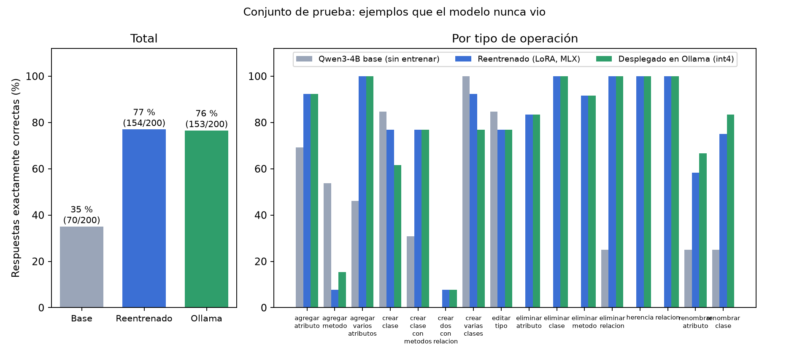
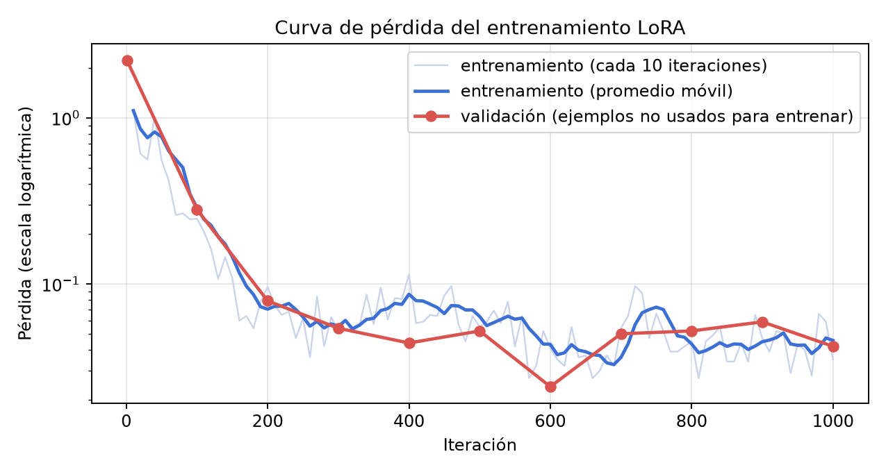
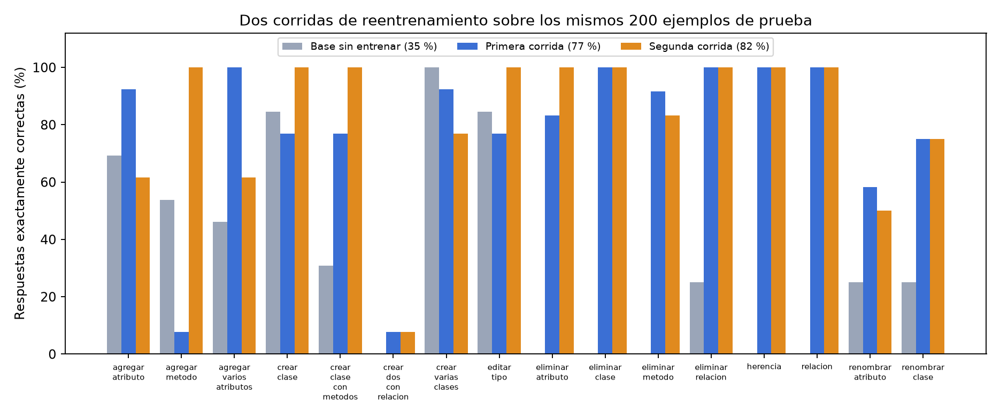

# Reentrenamiento del modelo de IA

| | |
|---|---|
| **Qué se hizo** | Se reentrenó (*fine-tuning* con LoRA) un modelo abierto de la familia Qwen para convertir un pedido en el JSON de cambios que entiende el editor, se midió contra el modelo sin entrenar y se desplegó en Ollama |
| **Dónde** | En un Mac con chip Apple M5 y 16 GB de memoria, con MLX |
| **Código y evidencia** | Carpeta `ml/` del repositorio (rama `feat/ia-reentrenada`): generador de datos, entrenamiento, evaluación, scripts de despliegue y la carpeta de cada corrida con sus registros |
| **Estado** | Dos corridas completas (2026-10-22). La plataforma usa la segunda: **82 %** de aciertos en ejemplos que nunca vio, contra 35 % del modelo sin entrenar |

## 1. Objetivo y alcance

El docente planteó la IA local como un extra **no obligatorio y valorable** (apuntes de clase). La interpretación del equipo, coincidente con la de otros grupos, es que se espera un modelo abierto **reentrenado por el propio equipo, desplegado y con la explicación de cómo se entrenó**. Este anexo documenta eso con evidencia reproducible. La plataforma sigue funcionando con Gemini por defecto; el modelo reentrenado es opcional y se activa por configuración.

## 2. Cómo funciona el reentrenamiento

- El **modelo base** (Qwen3-4B-Instruct, 4 mil millones de parámetros, cuantizado a 4 bits) ya sabe español, programar y escribir JSON.
- El ***fine-tuning*** le da cientos de ejemplos resueltos de *esta* tarea (diagrama actual + pedido → JSON exacto) para que practique y corrija sus errores.
- **LoRA** (Hu et al., 2021) congela el modelo y entrena solo unas matrices pequeñas de bajo rango añadidas a sus capas: aquí **22 millones de parámetros, el 0,55 % del total**. El resultado es un **adaptador** de 88 MB. **QLoRA** (Dettmers et al., 2023) hace lo mismo sobre el modelo cuantizado, lo que permite entrenar en 16 GB.
- La **pérdida** mide cuánto se equivoca el modelo al predecir cada palabra del JSON correcto; debe bajar. Solo se mide sobre la respuesta, no sobre el pedido.

## 3. Diseño del experimento

### 3.1 Datos

- **Generador determinista** (`ml/data/generar_dataset.py`, semilla fija): 16 tipos de operación (crear clase, agregar atributo, método o varios atributos, cambiar tipo, renombrar atributo o clase, eliminar atributo, método, clase o relación, crear relaciones, herencia, crear varias clases...), con redacciones variadas (sinónimos, tuteo, errores leves de ortografía, «por favor»).
- **Respuestas correctas por construcción:** el JSON esperado lo calcula el programa con reglas, no otro modelo. Al modificar una clase existente se pide la clase completa (mismo id, todos sus atributos y métodos); al eliminar se pide solo la marca `eliminar`.
- **Prompt corto:** el modelo aprende las reglas del editor, así que el pedido solo lleva el diagrama compacto (ids cortos, sin posiciones) y la frase. El proveedor de la plataforma (`modelo_reentrenado.py`) traduce los ids largos del editor a cortos y vuelve a los reales en la respuesta; una prueba automática garantiza que el texto del prompt sea idéntico al del entrenamiento.
- **Conjuntos:** 1500 ejemplos de entrenamiento, 150 de validación y 200 de prueba. La prueba usa **entidades que el modelo nunca vio** (Paciente, Doctor, Vehículo, Canción, Mascota, Película, Gimnasio, Receta) y **redacciones reservadas**; un script comprueba que no haya ejemplos repetidos entre entrenamiento y prueba.

### 3.2 Entrenamiento

LoRA de rango 16 sobre las últimas 24 capas, lote de 2, tasa de aprendizaje 1·10⁻⁴, 1000 iteraciones (≈ 1,3 épocas), secuencias de hasta 1024 *tokens*, validación cada 100 iteraciones y un punto de control cada 100. Duración: **1 h 23 min** en el Mac del equipo.

### 3.3 Evaluación

Se genera con decodificación determinista (temperatura 0) y se compara el JSON con el correcto en forma canónica: mismas clases, atributos con su tipo, métodos y relaciones con sus extremos, sin importar el orden ni los ids. Una respuesta cuenta como correcta **solo si es exactamente igual**; si el modelo pierde un atributo, inventa otro o devuelve un JSON roto, es incorrecta. Se mide el mismo conjunto de 200 ejemplos con tres modelos: el base sin entrenar, el reentrenado (MLX) y el reentrenado ya desplegado en Ollama.

## 4. Resultados de la primera corrida

*Figura B.1. Aciertos sobre 200 ejemplos que el modelo nunca vio.*

| Modelo | JSON válido | Respuestas exactamente correctas | Tiempo promedio |
|---|---|---|---|
| Qwen3-4B base, sin entrenar | 192/200 | **70/200** (35 %) | 4.7 s |
| Reentrenado con LoRA (MLX) | 197/200 | **154/200** (77 %) | 3.79 s |
| Reentrenado y desplegado en Ollama (int4) | 196/200 | **153/200** (76 %) | 4.46 s |

| Operación | Base | Reentrenado | Ollama |
|---|---|---|---|
| agregar atributo | 9/13 | 12/13 | 12/13 |
| agregar metodo | 7/13 | 1/13 | 2/13 |
| agregar varios atributos | 6/13 | 13/13 | 13/13 |
| crear clase | 11/13 | 10/13 | 8/13 |
| crear clase con metodos | 4/13 | 10/13 | 10/13 |
| crear dos con relacion | 0/13 | 1/13 | 1/13 |
| crear varias clases | 13/13 | 12/13 | 10/13 |
| editar tipo | 11/13 | 10/13 | 10/13 |
| eliminar atributo | 0/12 | 10/12 | 10/12 |
| eliminar clase | 0/12 | 12/12 | 12/12 |
| eliminar metodo | 0/12 | 11/12 | 11/12 |
| eliminar relacion | 3/12 | 12/12 | 12/12 |
| herencia | 0/12 | 12/12 | 12/12 |
| relacion | 0/12 | 12/12 | 12/12 |
| renombrar atributo | 3/12 | 7/12 | 8/12 |
| renombrar clase | 3/12 | 9/12 | 10/12 |

La pérdida de validación bajó de 2,23 al inicio a 0,04 al final (mínimo de 0,024 en la iteración 600):

*Figura B.2. Curva de pérdida del entrenamiento y de la validación.*

## 5. Análisis

**Lo que mejoró con claridad.** El modelo pasó de acertar el 35 % al **77 %**. Las operaciones que el modelo sin entrenar casi nunca hacía bien pasaron a hacerse bien: relaciones, herencia y eliminar clase, atributo, método o relación (de entre 0 y 3 aciertos sobre 12 a entre 10 y 12 sobre 12). El modelo base tendía a devolver el diagrama completo en vez de solo el cambio, y al pedirle eliminar no marcaba nada; el reentrenado aprendió el formato exacto de la plataforma.

**Lo que no mejoró, y por qué.** Dos operaciones fallan, y una incluso empeora frente al modelo base:

- **Agregar un método** (de 7/13 a 1/13): el modelo devuelve la clase tal cual estaba, **sin agregar el método pedido**. Se verificó que no es un problema de redacción nueva: con frases iguales a las del entrenamiento solo acierta 7 de 24.
- **Crear dos clases con una relación** (1/13): el modelo mezcla atributos de otras clases del diagrama.

La hipótesis es que son operaciones con pocos ejemplos (unos 90 de 1500 cada una) y que, como casi toda la respuesta es una copia del diagrama, el aprendizaje de la parte que cambia queda diluido en 1000 iteraciones. Además, el **renombrar** mejoró pero sigue débil (7/12 y 9/12).

**Efecto de la cuantización.** Al importar el modelo a Ollama con cuantización a 4 bits se pierde un acierto (154 → 153), con diferencias pequeñas por operación (clase y varias clases bajan; renombrar sube). Se mide, no se oculta.

**Posible sobreajuste.** La pérdida de validación tuvo su mínimo en la iteración 600 (0,024) y después osciló entre 0,05 y 0,06: más iteraciones no mejoraron la validación. Un punto de control intermedio podría rendir igual o mejor.

## 6. Despliegue y uso en la plataforma

1. El adaptador se **fusiona** con el modelo (`mlx_lm fuse`) y se **importa a Ollama** como `uml-qwen-dia3` (el de la segunda corrida) con cuantización a 4 bits (3,4 GB). La importación es determinista: repetirla produce la misma imagen.
2. En la configuración del servidor se define `AI_PROVIDER=ollama` y `OLLAMA_CHANGE_MODEL=uml-qwen-dia3`. Las preguntas y la revisión siguen con el modelo general (por ejemplo, Qwen 3.5 de 9 B); los **cambios al diagrama** los atiende el modelo reentrenado. El chat muestra «IA local (…; cambios: uml-qwen-dia3 reentrenado)».
3. La plataforma **no confía ciegamente en el modelo**: el guardia de cambios valida el tamaño, cuenta lo que se eliminaría y, si la respuesta deja fuera atributos o métodos de una clase existente, el navegador pide confirmación antes de aplicarla. Así, un fallo como el de «agregar método» (que no agrega nada) no destruye datos.

## 7. Segunda corrida

La primera corrida mostró qué fallaba (sección 5), así que se hizo una **segunda iteración** del proceso: diagnosticar, corregir los datos y volver a medir con **exactamente los mismos 200 ejemplos de prueba** (se reutilizó el archivo de la primera corrida, y se comprobó de nuevo que no hay ejemplos repetidos con el entrenamiento).

**Qué cambió.** 2000 ejemplos de entrenamiento en lugar de 1500, con las operaciones que fallaban **sobrerrepresentadas** (agregar método y crear dos clases con relación ×4; renombrar, crear clase, cambiar tipo y crear clase con métodos ×2) y 1500 iteraciones en lugar de 1000 (≈ 1,5 épocas). El resto de la configuración es idéntico. Duró **2 h 02 min**.

**Resultado.** El modelo reentrenado pasó a acertar **164 de 200 (82 %)**, contra 154 (77 %) de la primera corrida y 70 (35 %) del modelo base. Además, **el 100 % de las respuestas fueron un JSON válido** (200 de 200; antes 197 y, sin entrenar, 192). Ya desplegado en Ollama con cuantización a 4 bits **acierta lo mismo** (164 de 200): esta vez la cuantización no costó nada.

*Figura B.3. Aciertos por operación del modelo base y de las dos corridas.*

| Operación | Base | 1.ª corrida | 2.ª corrida | Cambio |
|---|---|---|---|---|
| agregar atributo | 9/13 | 12/13 | 8/13 | -4 |
| agregar metodo | 7/13 | 1/13 | 13/13 | +12 |
| agregar varios atributos | 6/13 | 13/13 | 8/13 | -5 |
| crear clase | 11/13 | 10/13 | 13/13 | +3 |
| crear clase con metodos | 4/13 | 10/13 | 13/13 | +3 |
| crear dos con relacion | 0/13 | 1/13 | 1/13 | = |
| crear varias clases | 13/13 | 12/13 | 10/13 | -2 |
| editar tipo | 11/13 | 10/13 | 13/13 | +3 |
| eliminar atributo | 0/12 | 10/12 | 12/12 | +2 |
| eliminar clase | 0/12 | 12/12 | 12/12 | = |
| eliminar metodo | 0/12 | 11/12 | 10/12 | -1 |
| eliminar relacion | 3/12 | 12/12 | 12/12 | = |
| herencia | 0/12 | 12/12 | 12/12 | = |
| relacion | 0/12 | 12/12 | 12/12 | = |
| renombrar atributo | 3/12 | 7/12 | 6/12 | -1 |
| renombrar clase | 3/12 | 9/12 | 9/12 | = |

**Lo que se corrigió.** *Agregar un método* pasó de 1 a 13 de 13 y *crear clase con métodos*, *crear clase* y *cambiar tipo* subieron a 13 de 13. Eliminar atributo, clase y relación, herencia y relación se mantienen perfectos.

**Lo que empeoró, y la lección.** Sobrerrepresentar un tipo de ejemplo tiene un costo en los vecinos: *agregar atributo* bajó de 12 a 8 y *agregar varios atributos* de 13 a 8. Al revisar las respuestas se ve el mecanismo: con frases poco habituales («Almacen debe tener además observaciones de tipo string»), el modelo ahora **agrega el campo como un método** en lugar de como un atributo. Es una confusión entre dos operaciones parecidas que el exceso de ejemplos de «agregar método» acentuó. *Crear dos clases con una relación* sigue sin funcionar (1 de 13: mezcla atributos de otras clases) y *renombrar atributo* se mantiene débil (6 de 12: a veces devuelve la clase sin renombrar).

**Conclusión.** El proceso funcionó como un ciclo de ingeniería: medir, diagnosticar, corregir y volver a medir; el total mejoró de 77 % a 82 % y desapareció el fallo más grave, pero la corrección de un punto movió el error a otro. El siguiente paso razonable sería equilibrar los pesos (por ejemplo, la misma cantidad de ejemplos de atributos y de métodos) y mejorar la redacción de los ejemplos de «crear dos clases». Para la plataforma se usa **la segunda corrida** (`uml-qwen-dia3`), la de mayor acierto.

### 7.1 Los 10 pedidos fijos de la plataforma

Los mismos 10 pedidos de `scripts/evaluar_ia.py` con los que se midieron Gemini y Qwen 3.5 de 9 B (Anexo A), esta vez con el modelo reentrenado haciendo los cambios (la revisión sigue con el modelo general): **JSON válido 10/10 y correctos 8/10** (el modelo de 9 B y Gemini acertaron 10/10). Fallan *crear dos clases y una relación* (la debilidad ya conocida) y *herencia*, donde el modelo **invirtió la dirección** (hizo padre al hijo). Cada cambio tarda unos 2 segundos, frente a 9 a 22 s de los otros modelos. Estos pedidos no se usaron para entrenar, aunque algunas frases se parecen a las plantillas, así que el conjunto de 200 ejemplos reservados es la medida principal.

**Defecto encontrado al evaluar con la plataforma real.** En el pedido «Cambia el tipo del atributo *total* de la clase *Pedido*» el modelo devolvió el nombre correcto pero **el id de otra clase** (*Cliente*). Aplicado tal cual, el editor habría renombrado *Cliente* como *Pedido* y le habría quitado sus atributos. El adaptador del proveedor ahora **da prioridad al nombre cuando es el de una clase que existe** (y mantiene el id cuando se trata de un renombrado a un nombre nuevo); hay pruebas automáticas de ambos casos y el pedido pasó de fallar a acertar (de 7/10 a 8/10).

## 8. Evidencia de que se entrenó de verdad

| Evidencia | Dónde |
|---|---|
| Registro crudo del entrenamiento, con pérdida por iteración, fechas y datos del equipo | `ml/runs/dia2/` y `ml/runs/dia3/`: `train.log`, `loss.csv`, `equipo.txt` |
| Adaptadores entrenados (88 117 092 bytes cada uno) con su hash SHA-256: 1.ª corrida `2a26ffd8…49477`, 2.ª corrida `46e8b11d…ee8d82` | `ml/runs/dia2/adaptador.sha256` y `ml/runs/dia3/adaptador.sha256` (los archivos pesan demasiado para el repositorio y no se versionan) |
| Datos y manifiesto (semilla, conteos, hashes, sin fugas entre entrenamiento y prueba) | `ml/runs/dia2/MANIFEST.json`, `ml/data/muestra_*.jsonl` |
| Resultados de cada modelo, con **cada respuesta cruda** | `ml/runs/dia2/eval-base.json`, `eval-reentrenado.json`, `eval-ollama.json` |
| Modelo desplegado en Ollama | `ml/runs/dia2/ollama-list.txt`, `ollama-modelfile.txt` |
| Todo repetible con un comando (semilla fija) | `ml/pipeline.sh <nombre> [iteraciones]` y `ml/README.md` |
| Pruebas automáticas del adaptador del proveedor (ids, parámetros de los métodos, errores) | `back_generador_bd/uml_api/tests/test_modelo_reentrenado.py` (19 pruebas) |

Se puede **mostrar un mini-entrenamiento en vivo** (100 iteraciones, unos 9 minutos) con `ml/train/entrenar.sh`.

## 9. Limitaciones

- Es un modelo pequeño entrenado con datos generados por plantillas: acierta mucho en lo que vio, y menos en operaciones poco frecuentes o con redacciones muy distintas.
- No supera a Gemini ni a un modelo grande en comprensión general; su ventaja es que corre sin internet, es ajustable y es barato.
- Solo se probó en un conjunto de 200 ejemplos generados; los 10 pedidos fijos de `scripts/evaluar_ia.py` se miden aparte (Anexo A).
- El servidor de AWS (2 GB de memoria) no puede ejecutarlo: se usa en el computador de quien presenta o en un servidor de IA con más memoria.
