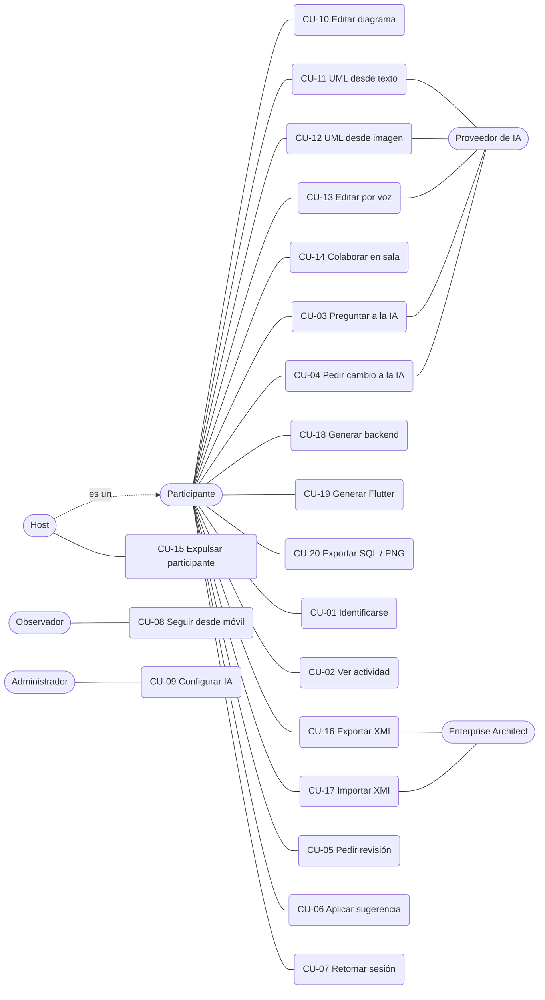

# Disciplina de Requisitos

Artefactos: **modelo de casos de uso**, **casos de uso detallados**, **requisitos adicionales** y **glosario**. Los requisitos numerados (RF-xx / RNF-xx) viven en [`../REQUIREMENTS.md`](../REQUIREMENTS.md); el plan agrega RF-23…RF-33 y RNF-04…RNF-07 (sección 4 de [`../PLAN_PUDS_IA_PARTICIPANTE.md`](../PLAN_PUDS_IA_PARTICIPANTE.md)).

## 1. Actores

| Actor | Descripción |
|---|---|
| **Participante** | Persona que entra a una sala y edita el diagrama. Sin cuentas: se identifica con un nombre y un identificador anónimo guardado en el navegador (RF-23). |
| **Host** | Participante que entró primero a la sala viva. Edita igual que los demás y además puede expulsar a otros (RF-12…RF-15). No es una persona distinta: es un **rol** temporal. |
| **Observador** *(✅ I5)* | Persona que sigue la sala desde el móvil, solo lectura (RF-32). |
| **Administrador** *(📋 I6)* | Configura el proveedor de IA (RF-33). |
| **IA** | Participante automático de la sala (RF-24). Solo actúa cuando un participante se lo pide. |
| **Enterprise Architect** | Herramienta externa con la que se intercambian modelos por XMI (RF-18). |
| **Proveedor de IA** | Servicio externo (Google Gemini) o local (Ollama/Qwen, opcional). |

## 2. Modelo de casos de uso

### Catálogo

| ID | Caso de uso | Requisitos | Estado |
|---|---|---|---|
| CU-10 | Editar el diagrama manualmente (clases, atributos, métodos, relaciones, multiplicidades; muchos-a-muchos con entidad intermedia; clase asociativa) | RF-01, RF-02 | ✅ |
| CU-11 | Crear o modificar UML desde texto en lenguaje natural | RF-03 | ✅ |
| CU-12 | Crear UML desde una imagen o foto | RF-04 | ✅ |
| CU-13 | Editar UML por voz | RF-05 | ✅ |
| CU-14 | Colaborar en una sala (entrar, sincronizar, reconectar, recuperar estado) | RF-06, RF-08, RF-10, RF-11 | ✅ |
| CU-15 | Expulsar a un participante (solo el host) | RF-07, RF-09, RF-14 | ✅ |
| CU-16 | Exportar el diagrama a XMI para Enterprise Architect | RF-18 | ✅ |
| CU-17 | Importar un modelo XMI | RF-18 | ✅ |
| CU-18 | Generar backend Spring Boot + PostgreSQL y colección Postman | RF-19, RF-20 | ✅ |
| CU-19 | Generar proyecto Flutter con persistencia SQLite offline | RF-21, RNF-01, RF-22 (parcial) | ✅ |
| CU-20 | Exportar a SQL y a imagen PNG | RF-01 | ✅ |
| CU-01 | Identificarse al entrar a una sala | RF-23 | ✅ I1 |
| CU-02 | Ver la actividad del equipo | RF-25 | ✅ I1 |
| CU-03 | Preguntar a la IA (incluye "¿qué hizo X?") | RF-26, RF-27 | ✅ I2 |
| CU-04 | Pedirle a la IA un cambio en el diagrama | RF-28, RF-29 | ✅ I3 |
| CU-05 | Pedirle a la IA una revisión | RF-30 | ✅ I3 |
| CU-06 | Ver las ideas de la IA y aplicar una | RF-28 | ✅ I3 |
| CU-07 | Retomar una sesión anterior | RF-31 | ✅ I4 |
| CU-08 | Seguir la sala desde el móvil | RF-32 | ✅ I5 |
| CU-09 | Configurar el proveedor de IA | RF-33 | 📋 I6 (opcional) |

### Casos de uso críticos para la arquitectura

Siguiendo el material de la cátedra (el arquitecto parte de un conjunto reducido de casos de uso fundamentales), se priorizan:

1. **CU-14 Colaborar en una sala:** fija el canal de tiempo real, los roles y la recuperación de estado.
2. **CU-10 Editar el diagrama:** fija el modelo del grafo (JointJS) del que cuelgan exportaciones y generadores.
3. **CU-04 Pedir cambio a la IA:** atraviesa identidad, actividad, IA y colaboración; se valida primero con el prototipo vertical de I1.
4. **CU-16/CU-17 XMI:** fija el formato de intercambio con una herramienta externa.

## 3. Casos de uso detallados

### CU-14 — Colaborar en una sala *(✅)*

- **Actor:** Participante.
- **Precondición:** conoce el código de la sala.
- **Flujo básico:**
  1. Abre la sala. El navegador abre un WebSocket a `/ws/canvas/<sala>/`.
  2. El servidor lo registra, le asigna rol (host si es el primero, participante si no) y avisa la presencia a todos.
  3. El cliente pide el estado completo; otro participante lo envía (`full_state`) y el diagrama aparece.
  4. Cada cambio que hace el participante (agregar clase, editar texto, mover, enlazar, borrar) se envía como operación y los demás la aplican.
  5. Cada cierto tiempo el cliente guarda un respaldo del diagrama en el servidor.
- **Flujos alternos:**
  - *Primer participante:* no hay a quién pedir el estado; se carga el respaldo del servidor.
  - *Desconexión del host:* el participante más antiguo pasa a host (RF-15).
  - *Reconexión:* es una conexión nueva; recupera el diagrama pero **no** el rol anterior (RF-16, RF-17).
- **Postcondición:** todos los participantes ven el mismo diagrama.

### CU-15 — Expulsar a un participante *(✅)*

- **Actor:** Host.
- **Flujo básico:** el host pulsa "expulsar" junto a un participante; el servidor verifica que quien lo pide es el host actual, cierra la conexión del expulsado y actualiza la presencia.
- **Alterno:** si lo pide un no-host, el servidor responde `remove_rejected` y no pasa nada.

### CU-10 — Editar el diagrama manualmente *(✅)*

- **Flujo básico:** el participante agrega clases, edita nombre/atributos/métodos, las mueve y las une con relaciones (asociación, agregación, composición, generalización, dependencia) y multiplicidades.
- **Regla de entidad intermedia:** si una **asociación** queda con `*` en ambos extremos, el editor la reemplaza por una clase intermedia y dos relaciones 1:N. Agregación, composición, dependencia y generalización no se transforman. Si el usuario edita una de las patas generadas y deja de ser "muchos", se restaura la asociación original (no desaparece ninguna relación).
- **Clase asociativa:** una clase puede unirse a una asociación M:N con un conector punteado; los generadores la resuelven a dos relaciones 1:N.

### CU-16 / CU-17 — Exportar e importar XMI *(✅)*

- **Flujo básico (exportar):** el cliente envía el diagrama a `POST /api/xmi/export/`; el servidor genera XMI 2.1 y el navegador lo descarga. Enterprise Architect lo abre.
- **Flujo básico (importar):** el participante sube un `.xmi`; `POST /api/xmi/import/` lo valida (rechaza `DOCTYPE`/entidades externas) y devuelve el diagrama, con posición y tamaño si el archivo trae los metadatos del editor.
- **Alterno:** archivo mal formado o con construcciones inseguras → error claro, el diagrama actual no cambia.

### CU-18 — Generar backend *(✅)*

- **Flujo básico:** el cliente envía el diagrama al generador (`POST /generate`); este devuelve un `.zip` con proyecto Spring Boot (Java 21) + PostgreSQL y una colección Postman.
- **Postcondición:** el proyecto descomprimido compila con el Maven Wrapper incluido.

### CU-04 — Pedirle a la IA un cambio en el diagrama *(✅ I3)*

- **Actor:** Participante. **Actor secundario:** Proveedor de IA.
- **Precondición:** el participante tiene nombre y está en la sala.
- **Flujo básico:**
  1. En su chat, el participante elige el modo **Pedir cambio** y escribe el pedido.
  2. `POST /api/rooms/<sala>/ia/chat/` con `mode=change`: el servidor identifica al participante por su token, limita la tasa de pedidos y llama al proveedor de IA.
  3. El proveedor devuelve los cambios en el formato que ya entiende el editor (crear, editar o eliminar).
  4. El navegador del participante los aplica con la misma ruta de edición manual; cada operación viaja marcada `via_ia` y se propaga a todos.
  5. El servidor registra cada operación en la actividad como "IA … (a pedido de X)".
- **Alternos:** el proveedor falla → mensaje claro y el diagrama no cambia (RNF-05). Modo **Preguntar** → la IA responde sin tocar el diagrama (RF-28).

## 4. Requisitos adicionales (no funcionales)

| ID | Requisito | Verificación |
|---|---|---|
| RNF-01 | Persistencia local offline en el proyecto móvil generado (SQLite) | Prueba física con CRUD sin red |
| RNF-02 | Arquitectura desplegable, con documentación de AWS | [`../DESPLIEGUE.md`](../DESPLIEGUE.md); prueba de humo |
| RNF-03 | Documentación de ingeniería suficiente (arquitectura, requisitos, proceso, decisiones, trazabilidad, pruebas) | Este directorio |
| RNF-04 | Privacidad: el chat de una persona no es accesible por otras | ✅ Pruebas de privacidad, con comprobación de que fallan si se filtra (I2) |
| RNF-05 | Resiliencia: si la IA falla, el diagrama no se pierde | ✅ Pruebas con fallo del proveedor: 502, nada guardado, el diagrama no cambia (I2/I3) |
| RNF-06 | El registro de actividad no degrada la edición | ✅ Mover/redimensionar no se registra; tope de tasa y tamaño; un fallo de la base no frena el relé (I1) |
| RNF-07 | Despliegue reproducible con prueba de humo | ✅ Runbook; 📋 script (I7) |
| RNF-08 | Seguridad de XMI: sin lectura de archivos locales ni red al importar (XXE) | ✅ Pruebas dedicadas de XMI |
| RNF-09 | HTTPS y sin puertos internos expuestos al exterior | ✅ Solo 22, 80 y 443 abiertos (2026-10-21) |
| RNF-10 | El frontend no accede a `window`/`localStorage` sin protección (SSR) | ✅ Revisión en cada cambio |

## 5. Glosario

| Término | Significado |
|---|---|
| **Sala** | Espacio compartido, identificado por un código, donde varias personas editan un mismo diagrama. |
| **Host** | Rol temporal del participante más antiguo de la sala viva. |
| **Participante** | Cualquier persona conectada a la sala. |
| **Presencia** | Lista en vivo de quién está en la sala y con qué rol. |
| **Operación** | Mensaje pequeño que describe un cambio del diagrama (`add_class`, `edit_text`, `move`, …). |
| **Respaldo** | Copia JSON del diagrama guardada en el servidor para recuperar el estado. |
| **Entidad intermedia** | Clase que el editor crea para representar una relación muchos-a-muchos. |
| **Clase asociativa** | Clase UML unida a una asociación para describirla; los generadores la convierten en dos relaciones 1:N. |
| **Multiplicidad** | Cantidad de instancias que participan en un extremo de una relación (`1`, `0..1`, `*`, …). |
| **XMI** | Formato XML para intercambiar modelos UML entre herramientas. |
| **Enterprise Architect (EA)** | Herramienta CASE con la que se prueba el intercambio XMI. |
| **Registro de actividad** | Lista visible para todos de las acciones relevantes de la sala (quién hizo qué). |
| **Pedir cambio / Preguntar** | Los dos modos del chat con la IA: con modificación del diagrama o solo consulta. |
| **Sugerencia** | Idea de la IA que no cambia nada hasta que alguien la aplica. |
| **Artefacto** | Producto de trabajo del proceso (modelo, documento, plan). |
| **Hito** | Punto de cierre de una fase, definido por los artefactos disponibles. |
