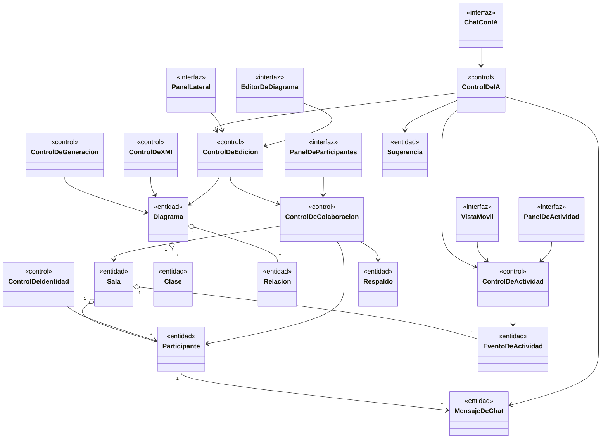
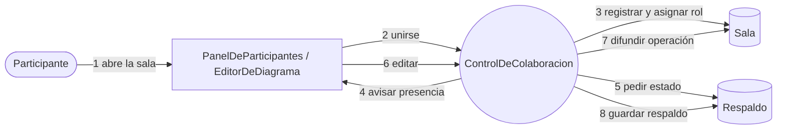
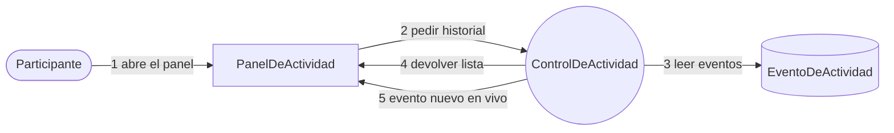
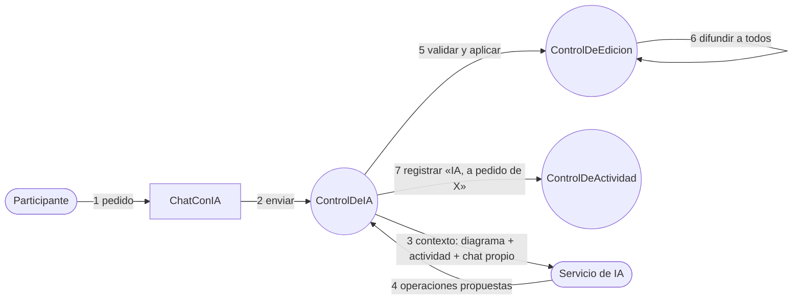

# Disciplina de Análisis

Artefactos: **clases de análisis**, **realización de casos de uso (análisis)** y **paquetes de análisis**. El modelo de análisis es conceptual: describe responsabilidades, no tecnología. El diseño ([`03-diseno.md`](03-diseno.md)) lo refina y lo adapta a Angular, Django y Spring.

Estereotipos usados (los del material de la cátedra): **interfaz** (frontera con el actor), **control** (coordina un caso de uso), **entidad** (información persistente o de larga vida).

## 1. Paquetes de análisis

El primer parcial identificó cinco paquetes. Los casos de uso nuevos no necesitaron un paquete nuevo: amplían dos de ellos.

| Paquete | Contenido | Casos de uso | Origen |
|---|---|---|---|
| **Gestión de lienzo** | Editor, Diagrama, Clase, Relación, Entidad intermedia, Clase asociativa | CU-01, CU-02, CU-05 | Primer parcial |
| **Colaboración** | Sala, Participante, Presencia, Operación, Respaldo, Evento de actividad | CU-03, CU-04; CU-14, CU-18, CU-19 | Se amplía |
| **Asistencia inteligente** | Pedido a la IA, Respuesta, Mensaje de chat, Sugerencia | CU-09; CU-15, CU-16, CU-17 | Se amplía |
| **Entrada multimodal** | Texto, imagen y voz como entrada del modelo | CU-06, CU-07, CU-08 | Primer parcial |
| **Exportación e integración** | Documento XMI, Esquema UML, Proyecto generado | CU-10, CU-11, CU-12, CU-13 | Primer parcial |

## 2. Clases de análisis

### Responsabilidades

| Clase | Estereotipo | Responsabilidad |
|---|---|---|
| EditorDeDiagrama | interfaz | Lienzo donde el participante dibuja y mueve clases y relaciones |
| PanelLateral | interfaz | Edición de nombre, atributos, métodos y multiplicidades |
| PanelDeParticipantes | interfaz | Muestra nombre, rol y "(Tú)"; el host ve el botón de expulsar |
| PanelDeActividad | interfaz | Lista, de más nueva a más vieja, quién hizo qué |
| ChatConIA | interfaz | Chat privado con modos Preguntar y Pedir cambio *(📋)* |
| VistaMovil | interfaz | Seguimiento de solo lectura *(📋)* |
| ControlDeEdicion | control | Aplica cambios al diagrama, aplica la regla de entidad intermedia, guarda localmente y programa el respaldo |
| ControlDeColaboracion | control | Envía y recibe operaciones, pide y entrega el estado completo, aplica roles y expulsión |
| ControlDeIdentidad | control | Mantiene el identificador anónimo y el nombre visible; los envía al entrar |
| ControlDeActividad | control | Decide qué acciones se registran (solo las relevantes), fusiona ediciones repetidas y las difunde |
| ControlDeIA | control | Arma el contexto, llama al proveedor, valida las respuestas y las convierte en operaciones o sugerencias *(📋)* |
| ControlDeXMI | control | Convierte el diagrama a XMI y viceversa, rechazando entradas inseguras |
| ControlDeGeneracion | control | Convierte el diagrama en proyecto Spring/Postman o Flutter |
| Diagrama / Clase / Relación | entidad | El modelo UML: clases con atributos y métodos; relaciones con tipo y multiplicidades |
| Sala / Participante | entidad | Quién está en la sala y con qué rol (vivo); identificador anónimo y nombre (persistente) |
| EventoDeActividad | entidad | Autor, tipo, objetivo, resumen y fecha de una acción |
| MensajeDeChat / Sugerencia | entidad | Conversación privada con la IA; idea propuesta que nadie aplicó aún |
| Respaldo | entidad | Copia del diagrama de la sala para recuperar el estado |

## 3. Realización de casos de uso (análisis)

### CU-03 Colaborar en tiempo real

### CU-14 Consultar la actividad del equipo

### CU-16 Pedirle a la IA un cambio en el diagrama

## 4. Reglas de análisis que se derivan

| Regla | Origen |
|---|---|
| La IA no modifica el diagrama sin un pedido explícito de un participante | RF-28 |
| Los cambios de la IA entran por la misma ruta que los manuales, así que se propagan y respetan las reglas del editor | RF-29 |
| El texto de un chat solo lo ve su dueño; la actividad es visible para todos | RNF-04, RF-25 |
| Mover o redimensionar nunca se registra | RNF-06 |
| El rol de host no sobrevive a la desconexión ni a la reconexión | RF-16, RF-17 |
| Una relación no desaparece en silencio: si una entidad intermedia deja de ser válida, se restaura la asociación original | Revisión de la entidad intermedia (I0) |
