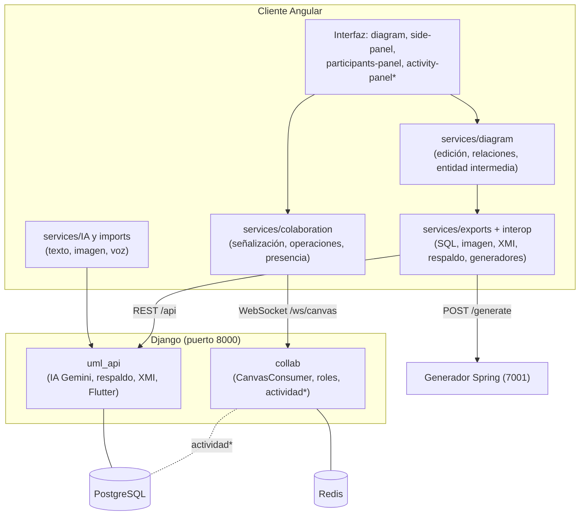
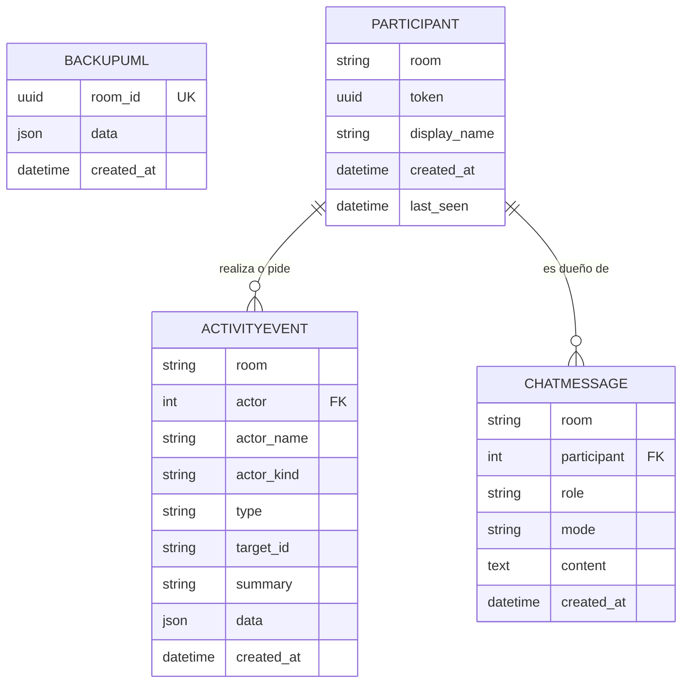
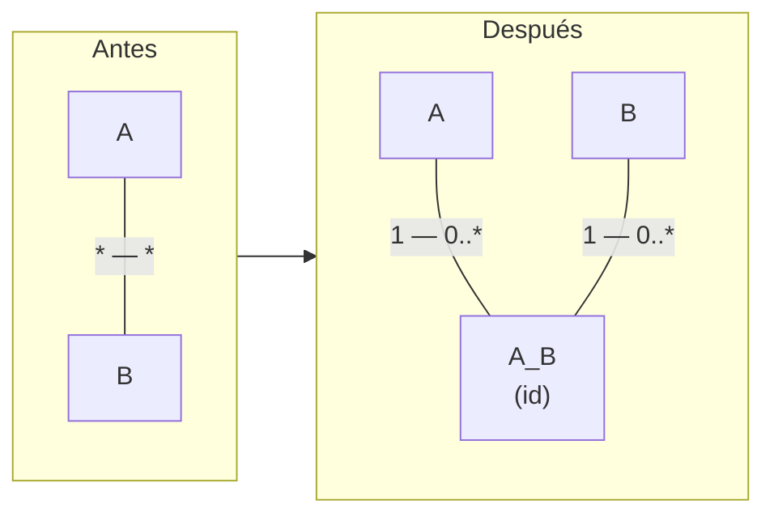
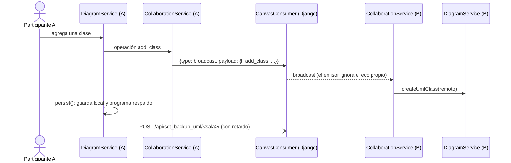
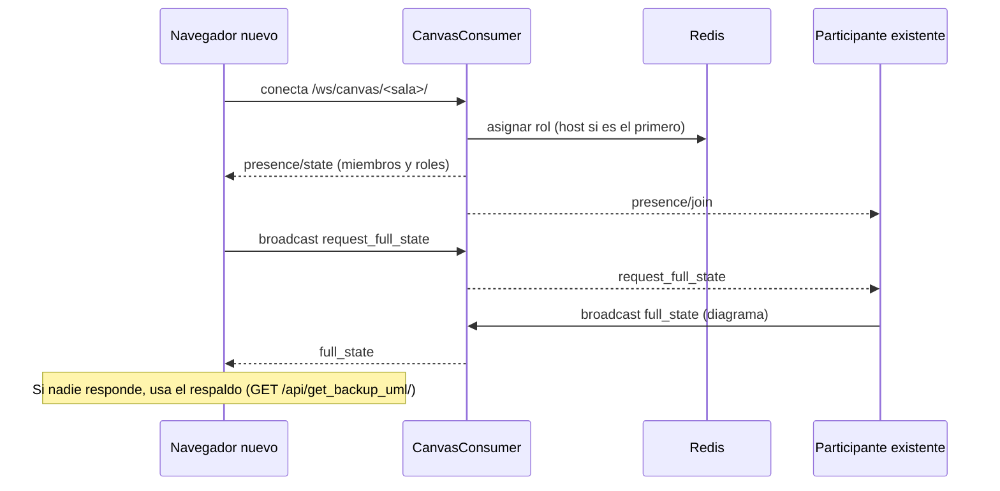
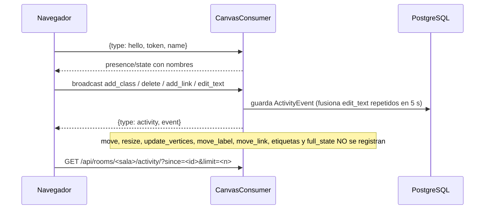
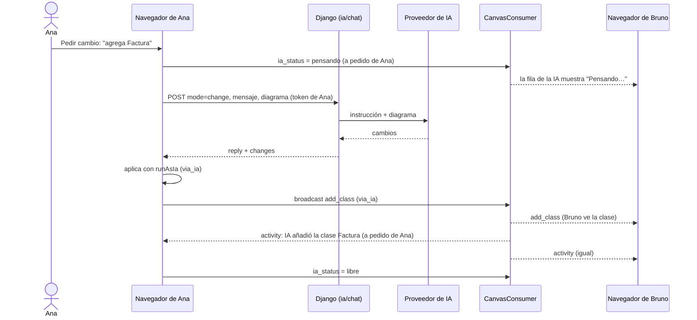
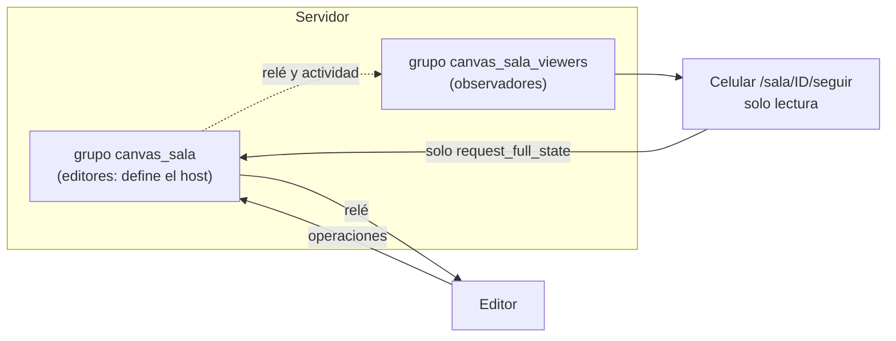
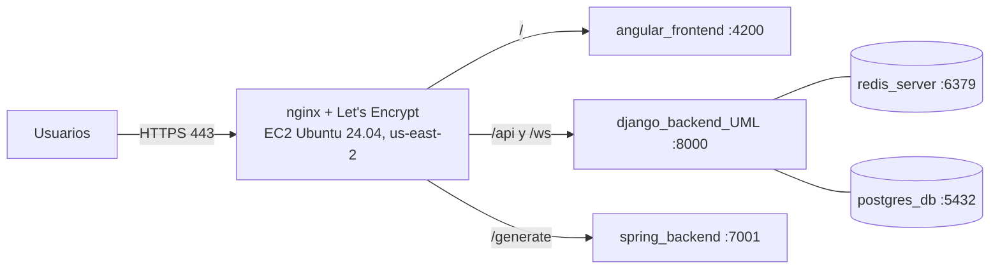

# Disciplina de Diseño

Artefactos: **descripción de la arquitectura**, **clases de diseño**, **subsistemas**, **interfaces**, **realización de casos de uso (diseño)** y **modelo de despliegue**. Lo marcado *(verificado)* se comprobó en el código; *(propuesta)* aún no existe. El diseño detallado de la IA participante (contratos, decisiones) está en las secciones 6 y 11 del [plan de trabajo](../PLAN_PUDS_IA_PARTICIPANTE.md).

## 1. Descripción de la arquitectura

### 1.1 Estilo

Aplicación web de tres capas más un generador independiente:

- **Cliente rico** (Angular 20 con renderizado en servidor + JointJS): toda la edición ocurre en el navegador; el grafo de JointJS es la fuente de verdad en vivo.
- **API y tiempo real** (Django 5, Django REST Framework, Channels/Daphne): endpoints REST para IA, respaldo, XMI y Flutter; un WebSocket por sala que **retransmite** operaciones y presencia.
- **Generador de código** (Spring Boot 3.5, Java 21): servicio sin estado que convierte el esquema UML en un proyecto Spring + PostgreSQL con colección Postman.
- **Persistencia:** PostgreSQL (respaldos de diagramas) y Redis (capa de canales y roles de sala).

Decisiones que definen la arquitectura *(verificado)*:

| Decisión | Motivo |
|---|---|
| El servidor **no guarda el estado vivo** del diagrama; solo retransmite operaciones y guarda un respaldo | Simplicidad y baja latencia; el respaldo basta para recuperar |
| Roles de sala solo en memoria compartida (Redis), derivados del orden de entrada | No hay cuentas (RF-16, RF-17) |
| Las operaciones viajan por el WebSocket del servidor (`broadcast`); la negociación WebRTC existe en el cliente pero **no transporta datos** | Una sola ruta de datos, fácil de depurar y desplegar detrás de nginx |
| Los generadores reciben el esquema exportado, no el grafo | Desacoplan el editor de los generadores |
| El editor resuelve sus direcciones según el origen de la página (HTTPS → mismo origen; HTTP → puertos 8000/7001) | Un mismo build sirve en local, EC2 y dominio |

### 1.2 Vista lógica: subsistemas

\* *En construcción (I1), ver sección 3.*

### 1.3 Subsistemas e interfaces *(verificado)*

| Subsistema | Ubicación | Interfaz que ofrece |
|---|---|---|
| Edición de diagramas | `front_generador_bd/src/services/diagram/` | `DiagramService`: crear/editar/borrar clases y relaciones, importar/exportar JSON, regla de entidad intermedia (`junction-naming.util.ts`, `association-class.util.ts`) |
| Colaboración (cliente) | `front_generador_bd/src/services/colaboration/` | `SignalingService` (WebSocket), `P2PService` (presencia y roles), `CollaborationService` (operaciones y estado completo) |
| Exportaciones | `front_generador_bd/src/services/exports/` | SQL, imagen PNG, respaldo, llamada al generador Spring |
| Interoperabilidad | `front_generador_bd/src/services/interop/xmi.service.ts` y `back_generador_bd/uml_api/services/xmi_service.py` | `POST /api/xmi/export/`, `POST /api/xmi/import/` |
| IA asistida | `front_generador_bd/src/services/IA/`, `imports/` y `back_generador_bd/uml_api/services/services_gemini.py` | `POST /api/chatbot/`, `/api/uml_from_image/`, `/api/uml_from_audio/` |
| Colaboración (servidor) | `back_generador_bd/collab/` | WebSocket `/ws/canvas/<sala>/` con mensajes `hello`, `broadcast`, `signal`, `remove_participant` y eventos `presence` (`self`, `join`, `leave`, `remove`, `state`) y `activity` |
| Chat con la IA | `back_generador_bd/uml_api/chat_views.py`, `services/ai_provider.py`, `services/ia_context.py`; cliente: `services/IA/ia-chat.service.ts`, `ia-actions.service.ts`, `app/ia-chat-panel` | `POST /api/rooms/<sala>/ia/chat/` (`mode`: `ask`, `change`, `review`) y `GET /api/rooms/<sala>/chat/`, ambos con la cabecera `X-Participant-Token` |
| Actividad | `back_generador_bd/collab/activity.py`, `uml_api/views.py`; cliente: `app/activity-panel` | `GET /api/rooms/<sala>/activity/?since=&limit=` |
| Respaldo | `back_generador_bd/uml_api/` (`BackupUML`) | `POST /api/set_backup_uml/<sala>/`, `GET /api/get_backup_uml/<sala>/` |
| Generador Flutter | `back_generador_bd/uml_api/services/flutter_generator.py` | `POST /api/generar_flutter/` |
| Generador Spring | `back_generator_uml/` (`ProjectGenerator`, `PostmanCollectionGenerator`, plantillas Mustache) | `POST /generate` → `.zip` |

## 2. Diseño de clases y datos

### 2.1 Modelo de datos

- `BackupUML` *(verificado)*: un respaldo por sala; `room_id` es UUID.
- `Participant`, `ActivityEvent` y `ChatMessage` *(✅ I1–I3, app `collab`, migraciones `0001`–`0003`)*: la sala es un `CharField` de hasta 64 caracteres, **no** se asume UUID; `(room, token)` es único; índice por `(room, created_at)`.
- En `ActivityEvent`, `actor_kind` es `user` o `ia`. Para eventos de la IA, `actor` apunta a **quien lo pidió** y `actor_name` es "IA"; las revisiones llevan en `data.findings` las ideas (`text`, `prompt`).
- `ChatMessage` guarda cada intercambio con su `mode` (`ask`, `change`, `review`) y siempre se consulta filtrando por el participante dueño.
- Las sugerencias no tienen tabla propia: viven dentro del evento `ia_review`, así son visibles para toda la sala.

### 2.2 Modelo del diagrama en el cliente *(verificado)*

Cada **clase** es un elemento de JointJS con nombre, atributos (`name`, `type`), métodos, posición y tamaño. Cada **relación** es un enlace con `relationType` (`association`, `aggregation`, `composition`, `generalization`, `dependency`, o `association-class` para el conector de clase asociativa) y dos etiquetas de multiplicidad. Marcas internas: `generatedJunction` y `generatedJunctionLeg` (entidad intermedia y sus patas), `junctionOrigin` (datos de la asociación original) y `junctionOptOut`.

### 2.3 Entidad intermedia (diseño)

- Solo las relaciones de tipo **asociación** con `*` en ambos extremos se transforman.
- El identificador de la intermedia incluye las dos clases (ordenadas) **y el identificador de la relación original**; el de cada pata incluye el rol (`source`/`target`). Así dos M:N paralelas entre las mismas clases generan entidades distintas (`A_B`, `A_B_2`, ordenadas por id de relación) y una M:N reflexiva funciona. Todos los clientes calculan los mismos identificadores.
- La intermedia nace con un atributo `id: int` como clave.
- Si una pata deja de ser "muchos" porque el usuario la edita, se restaura la asociación original y se retiran las celdas derivadas.
- En colaboración, las operaciones `add_class` y `add_link` llevan las marcas `generated`/`junctionOrigin`; aplicarlas dos veces es idempotente.

## 3. Realización de casos de uso (diseño)

### 3.1 Editar con colaboración (CU-10 + CU-14) *(verificado)*

### 3.2 Entrar a una sala y recuperar el estado *(verificado)*

### 3.3 Registro de actividad (CU-01, CU-02) *(✅ I1)*

### 3.4 Pedir cambio a la IA (CU-04) *(✅ I3)*

La IA actúa **desde el navegador de quien la invoca**: el servidor devuelve los cambios propuestos, el cliente los aplica por la ruta normal de edición y cada operación viaja marcada `via_ia`. Así se propagan igual que un cambio manual y el servidor las registra como "IA … (a pedido de X)".

Antes de aplicar, la interfaz pide confirmación si el cambio **elimina** elementos (el servidor cuenta las eliminaciones y rechaza cambios enormes), porque el modelo lee el contenido del diagrama y este puede venir de una importación.

Alternativas descartadas: IA del lado del servidor (exigiría una copia del diagrama en el servidor) y que el modelo decida si actuar (no verificable). En los modos `ask` y `review` el servidor **nunca** devuelve cambios; hay una prueba automática con un proveedor que devuelve un diagrama.

### 3.5 Revisar y aplicar ideas (CU-05, CU-06) *(✅ I3)*

`POST mode=review` pide al proveedor un JSON con observaciones; el servidor lo valida (máximo 5, solo texto), guarda un `ActivityEvent` de tipo `ia_review` y lo difunde a la sala por el canal. Cualquier participante puede pulsar **Aplicar** en una idea: el navegador primero **reserva** la idea en el servidor (`POST /api/rooms/<sala>/activity/<evento>/apply/<n>/`, atómico; 409 si otra persona ya la tomó), después ejecuta un `mode=change` con el pedido de la idea, a nombre de quien aplica, y si el cambio no llega a aplicarse la libera (`DELETE`). El estado "aplicada" viaja dentro del evento (`data.applied`), por eso todos lo ven y sobrevive a recargar.

### 3.6 Vista de seguimiento móvil (CU-08) *(✅ I5)*

- Un observador se conecta a `/ws/canvas/<sala>/?mode=viewer`. El servidor lo mete en un grupo aparte, por lo que **no** entra al orden que define al host, no aparece en la presencia y no puede expulsar ni ser expulsado. Solo recibe operaciones y actividad (las operaciones y la actividad se envían a los dos grupos) y lo único que puede pedir es el estado completo; todo lo demás que envíe se ignora.
- En el cliente, `DiagramService.initialize(..., {readOnly: true})` crea el lienzo sin interacción, no guarda en `localStorage` ni envía respaldos al servidor y no reconcilia entidades intermedias; `CollaborationService` no emite operaciones como observador. Aunque un error de código intentara emitir, el servidor lo descarta (doble barrera).
- La página (`app/follow-view`) ajusta el diagrama al ancho de la pantalla, deja el desplazamiento vertical al navegador (se puede acercar con los dedos) y muestra debajo la actividad y el estado de la IA; las ideas de la IA se ven pero no tienen botón de aplicar.

### 3.7 Identificación de cada conexión *(✅)*

Lo primero que recibe una conexión es `{type: presence, action: self, peer}` con su propio identificador. Antes el cliente lo deducía del primer aviso de presencia, y si otra persona entraba en el mismo instante tomaba su identificador y descartaba sus cambios como "propios". Los clientes viejos siguen funcionando porque el mensaje nuevo usa la misma forma que un aviso `join`.

## 4. Modelo de despliegue *(verificado, 2026-10-21)*

- Un solo servidor con Docker Compose; nginx es el único servicio expuesto (puertos 22, 80 y 443 en el grupo de seguridad).
- Dominio `diagramador.dev` (name.com); certificado con renovación automática.
- Procedimiento de despliegue, retroceso y pruebas de humo: [`../DESPLIEGUE.md`](../DESPLIEGUE.md).

## 5. Decisiones de diseño relevantes

| Decisión | Estado |
|---|---|
| El registro de actividad solo guarda acciones significativas, con topes de tasa y tamaño, y no bloquea la edición | ✅ I1 |
| Cada persona tiene su propio chat con la IA; las acciones son públicas y el texto de los chats es privado | ✅ I2 |
| La IA actúa desde el navegador del invocador y por la misma ruta que la edición manual | ✅ I3 |
| El proveedor de IA es intercambiable detrás de `AIProvider` (hoy Gemini; opcionalmente local con Ollama/Qwen) | ✅ interfaz · 📋 I6 proveedor local |
| Los errores del proveedor de IA nunca incluyen la clave de la API (las excepciones de `requests` traen la URL con la clave) | ✅ |
| Duplicación temporal aislada y documentada está permitida cerca de la entrega si evita refactorizar rutas estables de los generadores (`AGENTS.md`, regla 15) | ✅ |
