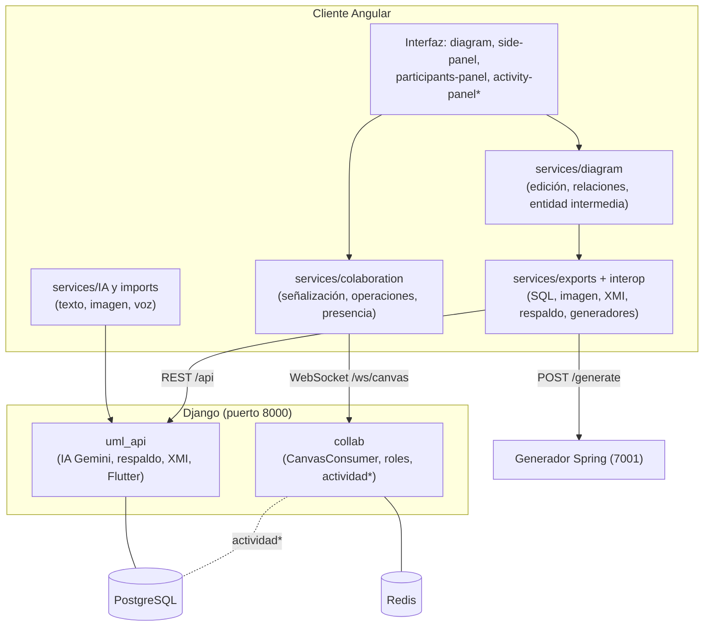
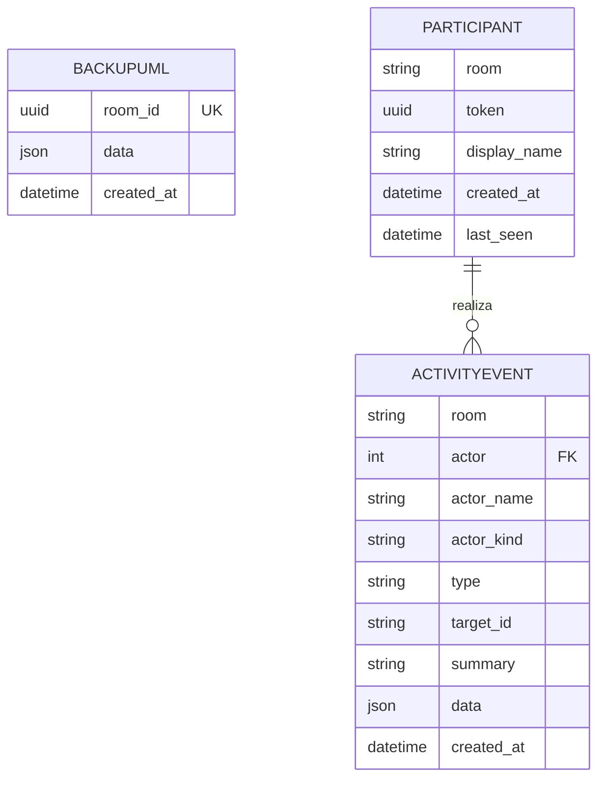
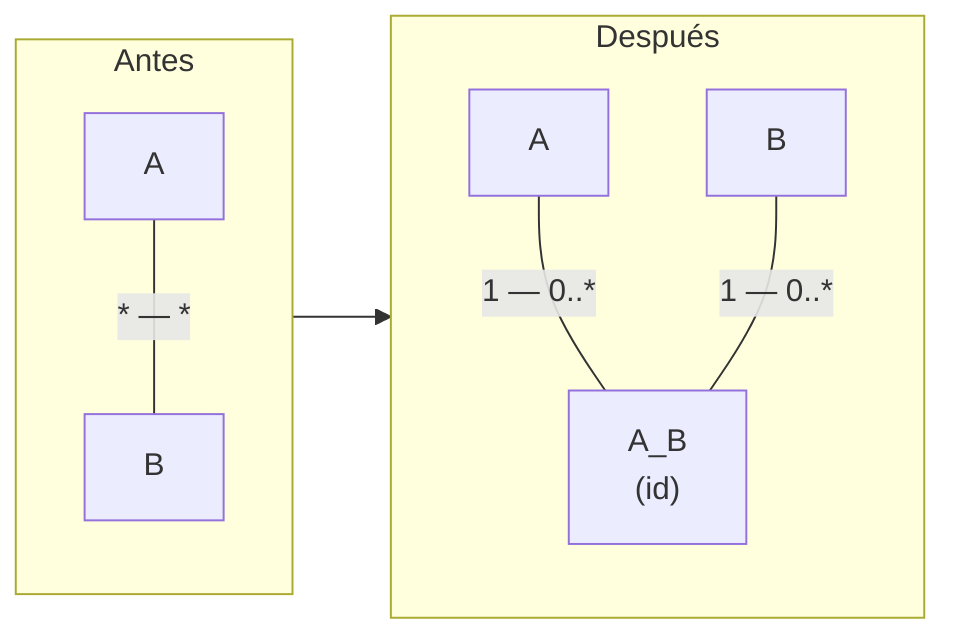
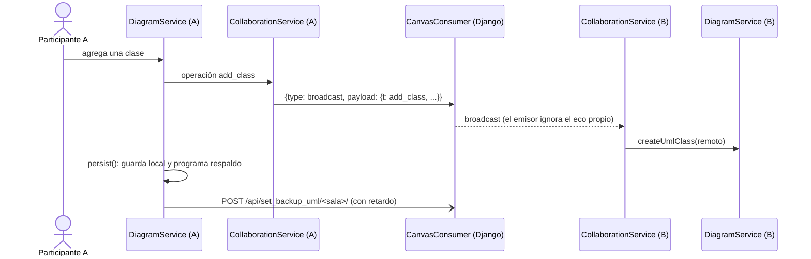
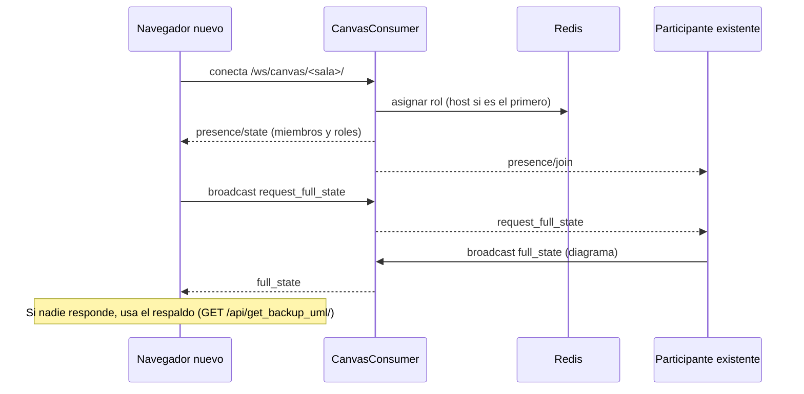
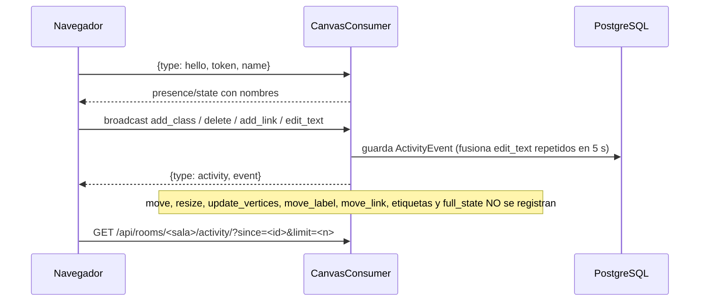
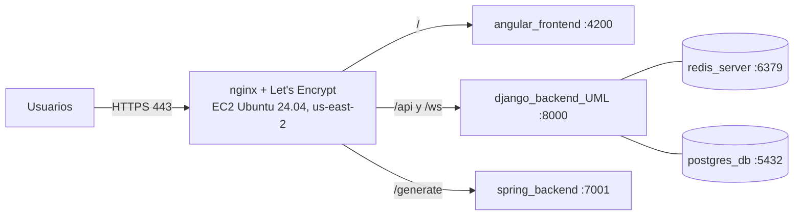

# Disciplina de Diseño

Artefactos: **descripción de la arquitectura**, **clases de diseño**, **subsistemas**, **interfaces**, **realización de casos de uso (diseño)** y **modelo de despliegue**. Lo marcado *(verificado)* se comprobó en el código; *(propuesta)* aún no existe. El diseño detallado de la IA participante (contratos, decisiones) está en las secciones 6 y 11 del [plan de trabajo](../PLAN_PUDS_IA_PARTICIPANTE.md).

## 1. Descripción de la arquitectura

### 1.1 Estilo

Aplicación web de tres capas más un generador independiente:

- **Cliente rico** (Angular 20 con renderizado en servidor + JointJS): toda la edición ocurre en el navegador; el grafo de JointJS es la fuente de verdad en vivo.
- **API y tiempo real** (Django 5, Django REST Framework, Channels/Daphne): endpoints REST para IA, respaldo, XMI y Flutter; un WebSocket por sala que **retransmite** operaciones y presencia.
- **Generador de código** (Spring Boot 3.5, Java 21): servicio sin estado que convierte el esquema UML en un proyecto Spring + PostgreSQL con colección Postman.
- **Persistencia:** PostgreSQL (respaldos de diagramas) y Redis (capa de canales y roles de sala).

Decisiones que definen la arquitectura *(verificado)*:

| Decisión | Motivo |
|---|---|
| El servidor **no guarda el estado vivo** del diagrama; solo retransmite operaciones y guarda un respaldo | Simplicidad y baja latencia; el respaldo basta para recuperar |
| Roles de sala solo en memoria compartida (Redis), derivados del orden de entrada | No hay cuentas (RF-16, RF-17) |
| Las operaciones viajan por el WebSocket del servidor (`broadcast`); la negociación WebRTC existe en el cliente pero **no transporta datos** | Una sola ruta de datos, fácil de depurar y desplegar detrás de nginx |
| Los generadores reciben el esquema exportado, no el grafo | Desacoplan el editor de los generadores |
| El editor resuelve sus direcciones según el origen de la página (HTTPS → mismo origen; HTTP → puertos 8000/7001) | Un mismo build sirve en local, EC2 y dominio |

### 1.2 Vista lógica: subsistemas

\* *En construcción (I1), ver sección 3.*

### 1.3 Subsistemas e interfaces *(verificado)*

| Subsistema | Ubicación | Interfaz que ofrece |
|---|---|---|
| Edición de diagramas | `front_generador_bd/src/services/diagram/` | `DiagramService`: crear/editar/borrar clases y relaciones, importar/exportar JSON, regla de entidad intermedia (`junction-naming.util.ts`, `association-class.util.ts`) |
| Colaboración (cliente) | `front_generador_bd/src/services/colaboration/` | `SignalingService` (WebSocket), `P2PService` (presencia y roles), `CollaborationService` (operaciones y estado completo) |
| Exportaciones | `front_generador_bd/src/services/exports/` | SQL, imagen PNG, respaldo, llamada al generador Spring |
| Interoperabilidad | `front_generador_bd/src/services/interop/xmi.service.ts` y `back_generador_bd/uml_api/services/xmi_service.py` | `POST /api/xmi/export/`, `POST /api/xmi/import/` |
| IA asistida | `front_generador_bd/src/services/IA/`, `imports/` y `back_generador_bd/uml_api/services/services_gemini.py` | `POST /api/chatbot/`, `/api/uml_from_image/`, `/api/uml_from_audio/` |
| Colaboración (servidor) | `back_generador_bd/collab/` | WebSocket `/ws/canvas/<sala>/` con mensajes `broadcast`, `signal`, `remove_participant` y eventos `presence` |
| Respaldo | `back_generador_bd/uml_api/` (`BackupUML`) | `POST /api/set_backup_uml/<sala>/`, `GET /api/get_backup_uml/<sala>/` |
| Generador Flutter | `back_generador_bd/uml_api/services/flutter_generator.py` | `POST /api/generar_flutter/` |
| Generador Spring | `back_generator_uml/` (`ProjectGenerator`, `PostmanCollectionGenerator`, plantillas Mustache) | `POST /generate` → `.zip` |

## 2. Diseño de clases y datos

### 2.1 Modelo de datos

- `BackupUML` *(verificado)*: un respaldo por sala; `room_id` es UUID.
- `Participant` y `ActivityEvent` *(🔄 I1, en la rama `feat/identidad-actividad`)*: la sala es un `CharField` de hasta 64 caracteres, **no** se asume UUID; `(room, token)` es único; índice por `(room, created_at)`.
- `MensajeDeChat` y `Sugerencia` *(📋 I2/I3, propuesta en la sección 6.4 del plan)*.

### 2.2 Modelo del diagrama en el cliente *(verificado)*

Cada **clase** es un elemento de JointJS con nombre, atributos (`name`, `type`), métodos, posición y tamaño. Cada **relación** es un enlace con `relationType` (`association`, `aggregation`, `composition`, `generalization`, `dependency`, o `association-class` para el conector de clase asociativa) y dos etiquetas de multiplicidad. Marcas internas: `generatedJunction` y `generatedJunctionLeg` (entidad intermedia y sus patas), `junctionOrigin` (datos de la asociación original) y `junctionOptOut`.

### 2.3 Entidad intermedia (diseño)

- Solo las relaciones de tipo **asociación** con `*` en ambos extremos se transforman.
- El identificador de la intermedia incluye las dos clases (ordenadas) **y el identificador de la relación original**; el de cada pata incluye el rol (`source`/`target`). Así dos M:N paralelas entre las mismas clases generan entidades distintas (`A_B`, `A_B_2`, ordenadas por id de relación) y una M:N reflexiva funciona. Todos los clientes calculan los mismos identificadores.
- La intermedia nace con un atributo `id: int` como clave.
- Si una pata deja de ser "muchos" porque el usuario la edita, se restaura la asociación original y se retiran las celdas derivadas.
- En colaboración, las operaciones `add_class` y `add_link` llevan las marcas `generated`/`junctionOrigin`; aplicarlas dos veces es idempotente.

## 3. Realización de casos de uso (diseño)

### 3.1 Editar con colaboración (CU-10 + CU-14) *(verificado)*

### 3.2 Entrar a una sala y recuperar el estado *(verificado)*

### 3.3 Registro de actividad (CU-01, CU-02) *(🔄 I1)*

### 3.4 Pedir cambio a la IA (CU-04) *(📋 I3, propuesta)*

La IA actúa **desde el navegador de quien la invoca**: el cliente recibe las operaciones propuestas, las valida y las aplica por la ruta normal de edición, de modo que se propagan igual que un cambio manual y quedan etiquetadas "IA, a pedido de X". Detalle y alternativas descartadas en la sección 6.3 y las decisiones de la 6.6 del plan.

## 4. Modelo de despliegue *(verificado, 2026-10-21)*

- Un solo servidor con Docker Compose; nginx es el único servicio expuesto (puertos 22, 80 y 443 en el grupo de seguridad).
- Dominio `diagramador.dev` (name.com); certificado con renovación automática.
- Procedimiento de despliegue, retroceso y pruebas de humo: [`../DESPLIEGUE.md`](../DESPLIEGUE.md).

## 5. Decisiones de diseño relevantes

| Decisión | Estado |
|---|---|
| El registro de actividad solo guarda acciones significativas y no bloquea la edición | 🔄 I1 |
| Cada persona tiene su propio chat con la IA; las acciones son públicas y el texto de los chats es privado | 📋 I2 |
| La IA actúa desde el navegador del invocador y por la misma ruta que la edición manual | 📋 I3 |
| El proveedor de IA es intercambiable (Gemini; opcionalmente local con Ollama/Qwen) | 📋 I6 |
| Duplicación temporal aislada y documentada está permitida cerca de la entrega si evita refactorizar rutas estables de los generadores (`AGENTS.md`, regla 15) | ✅ |
